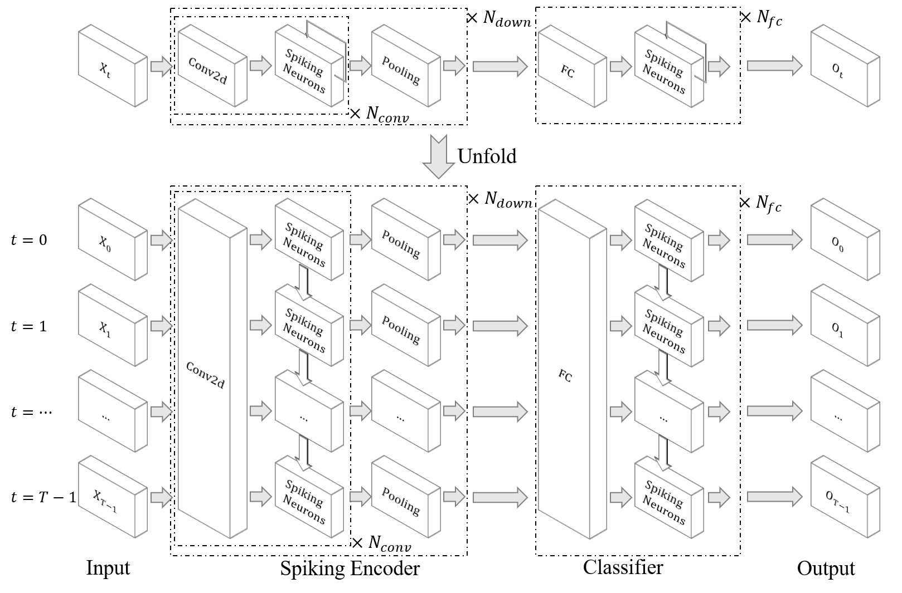

分类 DVS Gesture
=======================================
本教程作者： `fangwei123456 <https://github.com/fangwei123456>`_

English version: :doc:`../en/classify_dvsg`

在 :doc:`./neuromorphic_datasets` 中我们已经学习了如何使用神经形态数据集，下面让我们搭建SNN对其进行分类。

网络结构
-------------------------------------------
我们将使用 [#PLIF]_ 一文中定义的网络，其结构如下：

[#PLIF]_ 一文中的所有网络都在 :class:`spikingjelly.activation_based.model.parametric_lif_net` 中进行了定义，其中用于DVS Gesture的网络结构为：

.. code-block:: python

    # spikingjelly.activation_based.model.parametric_lif_net

    import torch
    import torch.nn as nn
    from .. import layer

    class DVSGestureNet(nn.Module):
        def __init__(self, channels=128, spiking_neuron: callable = None, *args, **kwargs):
            super().__init__()

            conv = []
            for i in range(5):
                if conv.__len__() == 0:
                    in_channels = 2
                else:
                    in_channels = channels

                conv.append(layer.Conv2d(in_channels, channels, kernel_size=3, padding=1, bias=False))
                conv.append(layer.BatchNorm2d(channels))
                conv.append(spiking_neuron(*args, **kwargs))
                conv.append(layer.MaxPool2d(2, 2))

            self.conv_fc = nn.Sequential(
                *conv,

                layer.Flatten(),
                layer.Dropout(0.5),
                layer.Linear(channels * 4 * 4, 512),
                spiking_neuron(*args, **kwargs),

                layer.Dropout(0.5),
                layer.Linear(512, 110),
                spiking_neuron(*args, **kwargs),

                layer.VotingLayer(10)
            )

        def forward(self, x: torch.Tensor):
            return self.conv_fc(x)

训练
-------------------------------------------
训练循环沿用 :doc:`./conv_fashion_mnist`，本节介绍 DVS Gesture 所需的改动。

定义网络，使用多步模式。神经元会根据输入设备自动选择实现：

.. code-block:: python

    # spikingjelly.activation_based.examples.classify_dvsg

    import torch
    import sys
    import torch.nn.functional as F
    from torch.cuda import amp
    from spikingjelly.activation_based import functional, surrogate, neuron
    from spikingjelly.activation_based.model import parametric_lif_net
    from spikingjelly.datasets.dvs128_gesture import DVS128Gesture
    from torch.utils.data import DataLoader
    from torch.utils.tensorboard import SummaryWriter
    import time
    import os
    import argparse
    import datetime

    def main():
        # ...
        net = parametric_lif_net.DVSGestureNet(channels=args.channels, spiking_neuron=neuron.LIFNode, surrogate_function=surrogate.ATan(), detach_reset=True)

        functional.set_step_mode(net, 'm')
        # ...

新建数据集：

.. code-block:: python

    # spikingjelly.activation_based.examples.classify_dvsg

    def main():
        # ...
        train_set = DVS128Gesture(root=args.data_dir, train=True, data_type='frame', frames_number=args.T, split_by='number')
        test_set = DVS128Gesture(root=args.data_dir, train=False, data_type='frame', frames_number=args.T, split_by='number')
        # ...

注意，由 ``DataLoader`` 打包的数据，第0维总是batch维度，因此我们从 ``DataLoader`` 读取的数据实际上是 ``shape = [N, T, C, H, W]``，因此我们需要转换为\
SpikingJelly的多步模式使用的 ``shape = [T, N, C, H, W]``：

.. code-block:: python

    # spikingjelly.activation_based.examples.classify_dvsg

    def main():
        # ...
        for epoch in range(start_epoch, args.epochs):
            for frame, label in train_data_loader:
                optimizer.zero_grad()
                frame = frame.to(args.device)
                frame = frame.transpose(0, 1)  # [N, T, C, H, W] -> [T, N, C, H, W]
                # ...

            with torch.no_grad():
                for frame, label in test_data_loader:
                    frame = frame.to(args.device)
                    frame = frame.transpose(0, 1)  # [N, T, C, H, W] -> [T, N, C, H, W]
                    # ...

        # ...

DVS Gesture有11类，因此在生成one hot的target时别忘了设置为11类：

.. code-block:: python

    # spikingjelly.activation_based.examples.classify_dvsg

    def main():
        # ...
        label_onehot = F.one_hot(label, 11).float()
        # ...

``DVSGestureNet`` 输出形状为 ``[T, N, 11]``。末层 ``VotingLayer`` 对每组 10 个神经元取平均，所以每步输出不是二值脉冲；对时间维取平均得到分类分数。

.. code-block:: python

    # spikingjelly.activation_based.model.parametric_lif_net

    class DVSGestureNet(nn.Module):
        # ...
        def forward(self, x: torch.Tensor):
            return self.conv_fc(x)

使用时间平均后的分类分数计算损失和正确率：

.. code-block:: python

    # spikingjelly.activation_based.examples.classify_dvsg

    def main():
        # ...
        out_fr = net(frame).mean(0)
        loss = F.mse_loss(out_fr, label_onehot)
        # ...

运行我们的网络：

.. code-block:: shell

    python -m spikingjelly.activation_based.examples.classify_dvsg -T 16 -device cuda:0 -b 16 -epochs 64 -data-dir /datasets/DVSGesture/ -amp -opt adam -lr 0.001 -j 8

以下结果来自历史版本，未在当前 V2 上复测。

得到输出为：

.. code-block:: shell

    Namespace(T=16, device='cuda:0', b=16, epochs=64, j=8, data_dir='/datasets/DVSGesture/', out_dir='./logs', resume=None, amp=True, opt='adam', momentum=0.9, lr=0.001, channels=128)
    DVSGestureNet(
    (conv_fc): Sequential(...)
    ...
    )
    The directory [/datasets/DVSGesture/frames_number_16_split_by_number] already exists.
    The directory [/datasets/DVSGesture/frames_number_16_split_by_number] already exists.
    Mkdir ./logs/T16_b16_adam_lr0.001_c128_amp.
    Namespace(T=16, device='cuda:0', b=16, epochs=64, j=8, data_dir='/datasets/DVSGesture/', out_dir='./logs', resume=None, amp=True, opt='adam', momentum=0.9, lr=0.001, channels=128)
    ./logs/T16_b16_adam_lr0.001_c128_amp
    epoch = 0, train_loss = 0.0666, train_acc = 0.3964, test_loss = 0.0514, test_acc = 0.6042, max_test_acc = 0.6042
    train speed = 92.7646 images/s, test speed = 115.2935 images/s
    escape time = 2022-05-25 21:31:54

    Namespace(T=16, device='cuda:0', b=16, epochs=64, j=8, data_dir='/datasets/DVSGesture/', out_dir='./logs', resume=None, amp=True, opt='adam', momentum=0.9, lr=0.001, channels=128)
    ./logs/T16_b16_adam_lr0.001_c128_amp
    epoch = 1, train_loss = 0.0463, train_acc = 0.6036, test_loss = 0.0439, test_acc = 0.6319, max_test_acc = 0.6319
    train speed = 101.5938 images/s, test speed = 120.5184 images/s
    escape time = 2022-05-25 21:30:48

    ...

    Namespace(T=16, device='cuda:0', b=16, epochs=64, j=8, data_dir='/datasets/DVSGesture/', out_dir='./logs', resume=None, amp=True, opt='adam', momentum=0.9, lr=0.001, channels=128)
    ./logs/T16_b16_adam_lr0.001_c128_amp
    epoch = 63, train_loss = 0.0011, train_acc = 0.9991, test_loss = 0.0103, test_acc = 0.9375, max_test_acc = 0.9375
    train speed = 100.4324 images/s, test speed = 121.0402 images/s
    escape time = 2022-05-25 21:30:51

最终获得了 ``max_test_acc = 0.9375`` 的性能。

下图展示了训练过程中的正确率曲线：

.. image:: ../../_static/tutorials/classify_dvsg/dvsg_logs.*
    :width: 100%

.. [#PLIF] Fang, Wei, et al. "Incorporating learnable membrane time constant to enhance learning of spiking neural networks." Proceedings of the IEEE/CVF International Conference on Computer Vision (ICCV), 2021, pp. 2661-2671. `CVF <https://openaccess.thecvf.com/content/ICCV2021/html/Fang_Incorporating_Learnable_Membrane_Time_Constant_To_Enhance_Learning_of_Spiking_ICCV_2021_paper.html>`_
