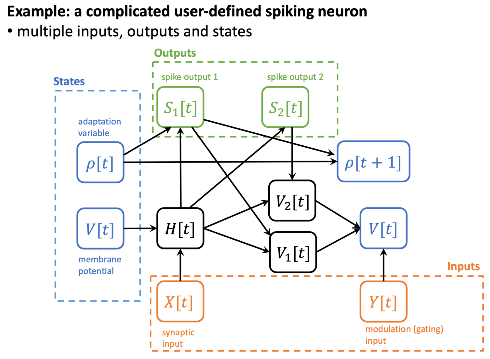

FlexSN
======

作者：`黄一凡 (AllenYolk) <https://github.com/AllenYolk>`_、`wei.fang <https://github.com/fangwei123456>`_

English version: :doc:`../en/flexsn`

``FlexSN`` 可以把用户用纯 PyTorch 编写的单步神经元动力学转换成有状态的
SpikingJelly 神经元，并为多步 CUDA 计算生成 Triton 内核。预定义 IF、LIF、PLIF
神经元的设备分发用法见 :doc:`./triton_backend`。

你可以用 FlexSN 定义自己的神经元动力学。使用内置神经元时，调用公开的
神经元或函数式接口。

.. note::

    示例中的 ``torch.sigmoid`` 输出连续值，用来展示函数组合和梯度。内置 LIF 则采用
    阶跃前向和替代梯度，两者不等价。构造时会用单位 Tensor 执行 core，因此 core
    应保持纯函数，不捕获 Tensor 或模块；参数通过 ``static_inputs`` 传入。

用函数描述神经元动力学
----------------------

绝大多数脉冲神经元在一个离散时间步上的动力学可以写成

.. math::

    Y_1[t], Y_2[t], \dots, V_1[t], V_2[t], \dots =
    f_s\left(X_1[t], X_2[t], \dots, V_1[t-1], V_2[t-1], \dots\right).

其中 :math:`X_i` 是输入，:math:`Y_i` 是输出，:math:`V_i` 是跨时间步保存的状态。
在 ``FlexSN`` 中，对应的 Python 函数签名为

.. code-block:: text

    core(*step_inputs, *states, *static_inputs)
        -> (*outputs, *updated_states)

返回值末尾的 ``num_states`` 个 Tensor 必须与输入状态一一对应。以输入不衰减、
软重置 LIF 的平滑近似为例：

.. code-block:: python

    import torch

    def lif_core(x: torch.Tensor, v: torch.Tensor):
        h = 0.5 * v + x
        spike = torch.sigmoid(h - 1.0)
        v = h - spike
        return spike, v

``core`` 必须是纯函数，不能捕获 Tensor 或 ``nn.Module``。普通数值超参数可以放进
闭包；需要训练或随 ``state_dict`` 保存的 Tensor 应通过后文的 ``static_inputs``
传入。

构造一个多状态神经元
--------------------

考虑一个具有双输入、双输出和双状态的神经元。``rho`` 调整第一个输出的阈值，
``y`` 控制硬重置与软重置的混合比例：

.. code-block:: python

    import torch

    def complicated_lif_core_generator(beta: float, gamma: float):
        def complicated_lif_core(
            x: torch.Tensor,
            y: torch.Tensor,
            v: torch.Tensor,
            rho: torch.Tensor,
        ):
            h = beta * v + x
            s1 = torch.sigmoid(h - (rho + 1.0))
            s2 = torch.sigmoid(h - 1.0)
            rho = gamma * rho + s1
            v_hard = h * (1.0 - s1)
            v_soft = h - s2
            modulation = torch.sigmoid(y)
            v = v_hard * modulation + v_soft * (1.0 - modulation)
            return s1, s2, v, rho

        return complicated_lif_core

该模型中，前两个返回值是输出，最后两个返回值是更新后的 ``v`` 和 ``rho``：

构造 ``FlexSN`` 时传入状态数量。输入和输出数量由函数签名及一次单位 Tensor
调用推导，构造函数无需示例输入：

.. code-block:: python

    from spikingjelly.activation_based import neuron

    f = neuron.FlexSN(
        core=complicated_lif_core_generator(beta=0.5, gamma=0.9),
        num_states=2,
        step_mode="m",
        store_state_seqs=True,
    ).cuda()

    x = torch.randn([16, 3, 32, 32], device="cuda")
    y = torch.randn([16, 3, 32, 32], device="cuda")
    s1, s2 = f(x, y)
    v_seq, rho_seq = f.state_seqs
    final_v, final_rho = f.states

    print(s1.shape, s2.shape)
    print(v_seq.shape, rho_seq.shape)
    print(final_v.shape, final_rho.shape)

输出和状态序列的形状为 ``[16, 3, 32, 32]``，最终状态的形状为
``[3, 32, 32]``。当 ``core`` 只有一个输出时，``forward`` 直接返回 Tensor；有多个输出时返回 tuple。
``states`` 和 ``state_seqs`` 始终是 tuple。处理完一段独立序列后，应调用 ``reset()``
清除托管状态。

模块状态与函数式调用
--------------------

``forward`` 会自动初始化、更新并保存状态。需要显式管理状态时，可以调用
``functional_forward``；该调用不修改模块中的 ``states``：

.. code-block:: python

    f_torch = neuron.FlexSN(
        core=complicated_lif_core_generator(beta=0.5, gamma=0.9),
        num_states=2,
    )
    initial_states = (
        torch.zeros_like(x[0]),
        torch.zeros_like(x[0]),
    )
    (s1, s2), (final_v, final_rho) = f_torch.functional_forward(
        (x, y), initial_states
    )
    assert f_torch.states == (None, None)

默认状态是与第一个输入的单步切片同形的零 Tensor。自定义初始化规则时，可继承
``FlexSN`` 并覆盖 ``init_states``：

.. code-block:: python

    class NonzeroFlexSN(neuron.FlexSN):
        @staticmethod
        def init_states(num_states, step_mode, *inputs):
            reference = inputs[0] if step_mode == "s" else inputs[0][0]
            return tuple(torch.ones_like(reference) for _ in range(num_states))

静态输入
--------

每个时间步重复使用的 Tensor 通过 ``static_inputs`` 传入。``Parameter`` 会注册为
模块参数，其他 Tensor 会注册为 buffer；两者都会出现在 ``state_dict`` 中。以下
PLIF 动力学使用可训练参数控制膜电位衰减：

.. code-block:: python

    def plif_core(x, v, w):
        reciprocal_tau = w.sigmoid()
        h = v + reciprocal_tau * (x - v)
        spike = torch.sigmoid(h - 1.0)
        return spike, h * (1.0 - spike)

    w = torch.nn.Parameter(torch.tensor(0.0))
    plif = neuron.FlexSN(
        plif_core,
        num_states=1,
        static_inputs=(w,),
    )

``functional_forward`` 默认使用当前注册的静态输入，包括设备或 dtype 转换后的值。
因此 ``base.to_functional_forward`` 和 ``memopt.checkpoint_module`` 可以在网络中
为每个 FlexSN 绑定其自身参数。显式元组可覆盖本次调用的值，不替换模块参数：

.. code-block:: python

    x_seq = torch.randn(8, 4)
    v0 = (torch.zeros_like(x_seq[0]),)
    outputs, states = plif.functional_forward(
        (x_seq,), v0, static_inputs=(torch.tensor(1.0),)
    )

输入和状态的单步元素数、数据类型及设备必须相同。静态张量也须使用相同的数据类型
和设备，并且是标量或与单步输入具有相同元素数；不支持任意广播。
显式 ``()`` 表示没有静态输入，仅在未注册静态输入时有效。底层的
``single_step_functional_forward`` 和 ``multi_step_functional_forward`` 仍须
显式传入 ``static_inputs``。

自动执行与 ``torch.compile``
----------------------------------------

FlexSN 会自动选择执行路径。CPU 使用 Torch 实现；CUDA 上支持的 core 使用生成的
Triton 内核，已知不支持融合的组合使用 Torch/HOP 路径。构造函数不接收 backend 参数。

.. code-block:: python

    import torch.nn as nn
    from spikingjelly.activation_based import neuron

    flex = neuron.FlexSN(lif_core, 1).cuda()
    model = nn.Sequential(nn.Linear(512, 512), flex, nn.Linear(512, 512)).cuda()
    compiled = torch.compile(model, fullgraph=True)
    output = compiled(torch.randn(8, 64, 512, device="cuda"))

支持的 CUDA core 会在首次接收真实 CUDA 输入时编译。选定 Triton 后的内核错误
会直接报告。

使用限制
--------

* 多步输入的首维是时间维 ``T``；``T == 0`` 会被拒绝。
* 单步模式直接执行 core；自动 CUDA 融合只用于 ``step_mode="m"``。
* 修改 step mode 会保留最终状态，但清除派生的 ``state_seqs``。

训练与状态管理
----------------------------

下面的训练示例使用可训练静态输入并保存完整轨迹。反向和参数更新后重置独立
batch；连续序列可保留状态。最后一次显式状态调用不改变模块的托管状态：

.. code-block:: python

    import torch
    from spikingjelly.activation_based import neuron

    def smooth_core(x, v, w):
        h = v + w.sigmoid() * (x - v)
        output = torch.sigmoid(h - 1.0)
        return output, h * (1.0 - output)

    device = torch.device("cuda:0" if torch.cuda.is_available() else "cpu")
    node = neuron.FlexSN(
        smooth_core,
        1,
        static_inputs=(torch.nn.Parameter(torch.tensor(0.0)),),
        store_state_seqs=True,
    ).to(device)
    optimizer = torch.optim.SGD(node.parameters(), lr=0.01)
    x = torch.rand(4, 2, 8, device=device, requires_grad=True)
    output = node(x)
    assert node.state_seqs[0].shape == x.shape
    (output.sum() + node.states[0].sum()).backward()
    assert node.static_inputs[0].grad is not None
    optimizer.step()
    node.reset()
    assert node.states == (None,)
    # Explicit-state calls return output/state tuples without changing managed state.
    outputs, states = node.functional_forward(
        (x.detach(),), (torch.zeros_like(x[0]),), static_inputs=node.static_inputs
    )
    assert outputs[0].shape == x.shape and states[0].shape == x.shape[1:]
    assert node.states == (None,)
