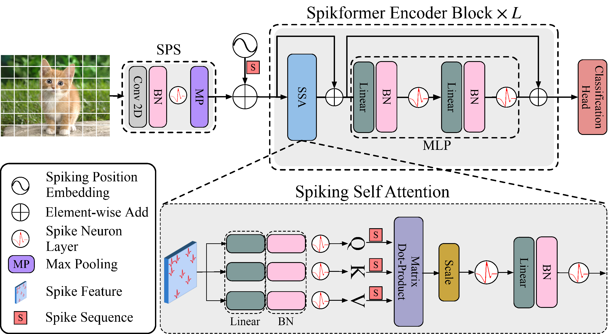
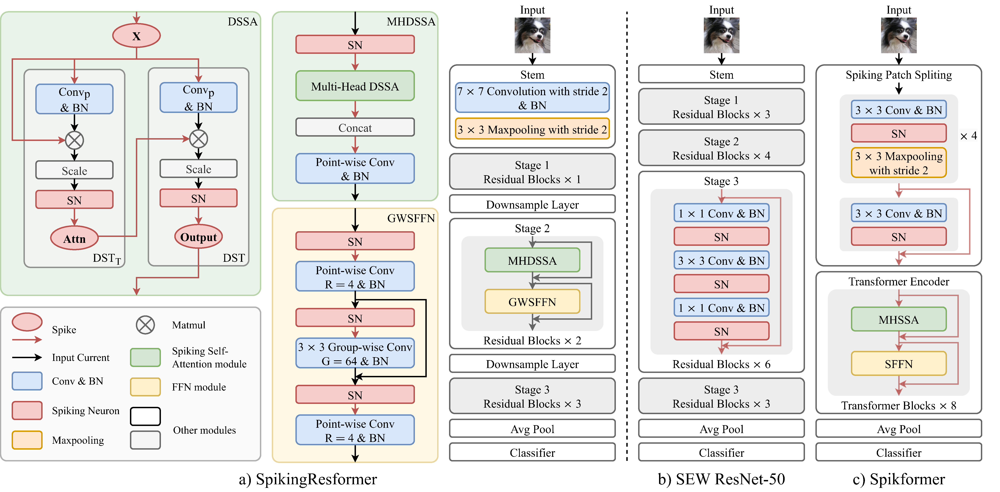

脉冲Transformer构建、训练和改进
=======================================

作者： `周昭坤 <https://github.com/ZK-Zhou>`_、`黄一凡 (AllenYolk) <https://github.com/AllenYolk>`_

English version: :doc:`../en/spikformer`

你将先实现 Spikformer [#spikformer]_ 的注意力模块，再构建完整的图像分类网络。Spikformer 的结构由三个主要组件组成：脉冲块分割前馈模块（Spiking Patch Splitting，SPS）、脉冲自注意力机制（Spiking Self Attention，SSA）和多层感知模块（Multi-Layer Perceptron，MLP），堆叠方式是一个 SPS 加若干个 SSA-MLP 组合块。训练流程见 :doc:`./train_large_scale_snn`；Spikformer 的分布式训练配置见 :doc:`./distributed_training`。具体的 SSA 和 Spikformer 如图所示：

构建脉冲Transformer
-----------------------------------

首先导入相关的模块：

.. code-block:: python

    import torch
    import torch.nn as nn
    from spikingjelly.activation_based import neuron

SSA 接收形状为 ``[T, B, N, C]`` 的序列，其中 T 是时间步数，B 是批量大小，N 是词元数量，C 是通道数。分别用线性投影、批归一化和 LIF 神经元生成 Q、K、V。神经元输出非负的二值脉冲，注意力直接使用它们的矩阵乘积，不使用 Softmax：

.. code-block:: python

    class SSA(nn.Module):
        def __init__(self, dim, num_heads=8):
            super().__init__()
            assert dim % num_heads == 0, f"dim {dim} should be divided by num_heads {num_heads}."
            self.dim = dim
            self.num_heads = num_heads
            self.scale = 0.125

            self.q_linear = nn.Linear(dim, dim)
            self.q_bn = nn.BatchNorm1d(dim)
            self.q_lif = neuron.LIFNode(step_mode="m", detach_reset=True)

            self.k_linear = nn.Linear(dim, dim)
            self.k_bn = nn.BatchNorm1d(dim)
            self.k_lif = neuron.LIFNode(step_mode="m", detach_reset=True)

            self.v_linear = nn.Linear(dim, dim)
            self.v_bn = nn.BatchNorm1d(dim)
            self.v_lif = neuron.LIFNode(step_mode="m", detach_reset=True)

            self.attn_lif = neuron.LIFNode(step_mode="m", v_threshold=0.5, detach_reset=True)

            self.proj_linear = nn.Linear(dim, dim)
            self.proj_bn = nn.BatchNorm1d(dim)
            self.proj_lif = neuron.LIFNode(step_mode="m", detach_reset=True)

        def forward(self, x):
            T,B,N,C = x.shape

            x_for_qkv = x.flatten(0, 1)  # TB, N, C
            q_linear_out = self.q_linear(x_for_qkv)  # [TB, N, C]
            q_linear_out = self.q_bn(q_linear_out. transpose(-1, -2)).transpose(-1, -2).reshape(T, B, N, C).contiguous()
            q_linear_out = self.q_lif(q_linear_out)
            q = q_linear_out.reshape(T, B, N, self.num_heads, C//self.num_heads).permute(0, 1, 3, 2, 4).contiguous()

            k_linear_out = self.k_linear(x_for_qkv)
            k_linear_out = self.k_bn(k_linear_out. transpose(-1, -2)).transpose(-1, -2).reshape(T, B, N, C).contiguous()
            k_linear_out = self.k_lif(k_linear_out)
            k = k_linear_out.reshape(T, B, N, self.num_heads, C//self.num_heads).permute(0, 1, 3, 2, 4).contiguous()

            v_linear_out = self.v_linear(x_for_qkv)
            v_linear_out = self.v_bn(v_linear_out. transpose(-1, -2)).transpose(-1, -2).reshape(T, B, N, C).contiguous()
            v_linear_out = self.v_lif(v_linear_out)
            v = v_linear_out.reshape(T, B, N, self.num_heads, C//self.num_heads).permute(0, 1, 3, 2, 4).contiguous()

            attn = (q @ k.transpose(-2, -1)) * self.scale

            x = attn @ v
            x = x.transpose(2, 3).reshape(T, B, N, C).contiguous()
            x = self.attn_lif(x)
            x = x.flatten(0, 1)
            x = self.proj_lif(self.proj_bn(self.proj_linear(x).transpose(-1, -2)).transpose(-1, -2).reshape(T, B, N, C))

            return x

将 SSA 与 :class:`spikingjelly.activation_based.model.spikformer.SpikformerMLP` 组合成 Transformer 块。MLP 要求词元维在最后，因此在调用前后转置张量。下面的加法使用 SEW 形式的残差，即分支先产生脉冲再相加；若改用 MS 形式的残差，则需调整 SSA 和 MLP 中神经元的位置：

.. code-block:: python

    from spikingjelly.activation_based.model.spikformer import SpikformerMLP

    class Block(nn.Module):
        def __init__(self, dim, num_heads, mlp_ratio=4.):
            super().__init__()
            self.attn = SSA(dim, num_heads=num_heads)
            mlp_hidden_dim = int(dim * mlp_ratio)
            self.mlp = SpikformerMLP(in_features=dim, hidden_features=mlp_hidden_dim, out_features=dim)

        def forward(self, x):
            x = x + self.attn(x)
            x = x + self.mlp(x.transpose(-1, -2)).transpose(-1, -2)
            return x

要构建包含图像分块、词元维在后的 Transformer 块和读出层的完整模型，可以使用 :func:`spikingjelly.activation_based.model.spikformer.spikformer_ti`：

.. code-block:: python

    import torch
    from spikingjelly.activation_based.model.spikformer import spikformer_ti
    from spikingjelly.activation_based import functional

    net = spikformer_ti(T=4, img_size_h=32, img_size_w=32, num_classes=10).eval()
    functional.set_step_mode(net, 'm')
    x_seq = torch.rand([4, 2, 3, 32, 32])
    with torch.no_grad():
        y_seq = net(x_seq)
    print(f'y_seq.shape={y_seq.shape}')
    functional.reset_net(net)

输出为 ``y_seq.shape=torch.Size([4, 2, 10])``，即每个时间步、每张图像各有一个类别得分向量。分类时用 ``y_seq.mean(0)`` 沿时间维取平均，处理下一批独立图像前重置神经元状态。

``spikformer_ti`` 是微型配置。``spikformer_s`` 和 ``spikformer_cifar10`` 分别提供小型 ImageNet 和 CIFAR-10 模型配置。训练默认参数由相应的训练配置类提供。

如果任务需要多种空间分辨率，你可以参考 QKformer 设计分层的 Spikformer。

SSA实现方式改进
-----------------------

SpikingJelly 提供了词元维在后的 SSA 实现 :class:`SpikingSelfAttention <spikingjelly.activation_based.layer.attention.SpikingSelfAttention>` 。
相比上一节中的 ``SSA``， :class:`SpikingSelfAttention <spikingjelly.activation_based.layer.attention.SpikingSelfAttention>` 从以下方向做出改进。

#. 输入和输出使用 ``[T, B, C, N]``，即词元维在最后。投影层使用 ``Conv1d``，省去 ``BatchNorm1d`` 前后的转置。
#. 将 Q、K、V 的三组 Conv-BN-LIF 合并成一组，通道数为原来的 3 倍，一次生成 ``q, k, v``。
#. 分头后的 ``q, k, v`` 从 ``[T, B, num_heads, N, C // num_heads]`` 变为 ``[T, B, num_heads, C // num_heads, N]``。逐头计算时，乘法从 ``q @ k.transpose(-2, -1) @ v`` 变为 ``v @ k.transpose(-2, -1) @ q``。

.. note::

    推导时只考虑一个注意力头，并用 C 表示该头的通道数。记原始形如 ``[T, B, N, C]`` 的 ``q, k, v`` 张量为 :math:`Q, K, V` 。则 SSA 中张量乘法（即：批量矩阵乘法）可表示为：

    .. math::

        X = Q K^T V ,

    其中 :math:`K^T` 代表对 :math:`K` 的最后两个维度做转置。改进后的 ``q, k, v`` 以及张量乘法所得的 ``x`` 都形如 ``[T, B, C, N]``，相当于 :math:`Q^T, K^T, V^T, X^T`。记这些词元维在后的张量为 :math:`Q', K', V', X'` ，则有

    .. math::

        X' &= X^T \\
           &= (Q K^T V)^T \\
           &= V^T K Q^T \\
           &= V' K'^T Q' .

    所以对于改进后的词元维在后张量而言，张量乘法顺序应为 ``v @ k.transpose(-2, -1) @ q`` 。

下面的实现展示上述改动。完整实现见 :class:`SpikingSelfAttention <spikingjelly.activation_based.layer.attention.SpikingSelfAttention>` 的文档与源码。

.. code:: python

    import torch
    import torch.nn as nn
    from spikingjelly.activation_based import neuron
    from spikingjelly.activation_based.layer import SeqToANNContainer

    class SpikingSelfAttention(nn.Module):
        def __init__(self, dim, num_heads=8):
            super().__init__()
            assert dim % num_heads == 0, f"dim {dim} should be divided by num_heads {num_heads}."
            self.dim = dim
            self.num_heads = num_heads
            self.head_dim = dim // num_heads
            self.scale = 0.125

            self.qkv_conv_bn = SeqToANNContainer(
                nn.Conv1d(dim, dim * 3, kernel_size=1, stride=1, bias=False),
                nn.BatchNorm1d(dim*3),
            )
            self.qkv_lif = neuron.LIFNode(step_mode="m", detach_reset=True)

            self.attn_lif = neuron.LIFNode(step_mode="m", v_threshold=0.5, detach_reset=True)

            self.proj_conv_bn = SeqToANNContainer(
                nn.Conv1d(dim, dim, kernel_size=1, stride=1, bias=False),
                nn.BatchNorm1d(dim),
            )
            self.proj_lif = neuron.LIFNode(step_mode="m", detach_reset=True)

        def forward(self, x_seq: torch.Tensor):
            T, B, C, N = x_seq.shape

            qkv = self.qkv_conv_bn(x_seq)
            qkv = self.qkv_lif(qkv) # [T, B, 3*C, N]
            qkv = qkv.reshape(T, B, 3*self.num_heads, C // self.num_heads, N)

            qt, kt, vt = qkv.chunk(3, dim=2)
            # qt, kt, vt.shape = [T, B, NUM_HEADS, Cph, N]
            x_seq = vt @ kt.transpose(-2, -1)
            x_seq = (x_seq@qt) * self.scale # [T, B, NUM_HEADS, Cph, N]

            x_seq = self.attn_lif(x_seq).reshape(T, B, C, N)

            x_seq = self.proj_conv_bn(x_seq)
            x_seq = self.proj_lif(x_seq) # [T, B, C, N]
            return x_seq

.. note::

    使用词元维在后张量格式后，``MLP`` 的实现方式也应从 ``Linear`` 改为 ``Conv1d``，以避免不必要的涉及数据复制的 ``reshape`` 操作。

改进脉冲Transformer
-------------------------------
脉冲自注意力机制的建模形式尚处于开放探索阶段，已有多种改进，改进点的具体位置有：改进QKV的形式和计算方式，增强QKV的时空关注能力，设计脉冲位置编码和SSA分块加速等。
也可以改进脉冲 Transformer 中的 MLP 和 SPS 前馈模块。
Spikformer 的一个变体是 SpikingResformer [#spikingresformer]_ ，如下图：

.. [#spikformer] Zhou Zhaokun, Zhu Yuesheng, He Chao, Wang Yaowei, Yan Shuicheng, Tian Yonghong, Yuan Li. Spikformer: When Spiking Neural Network Meets Transformer [C]. Proceedings of International Conference on Learning Representations, 2023.
.. [#spikingresformer] Shi Xinyu, Hao Zecheng, Yu Zhaofei. SpikingResformer: Bridging ResNet and Vision Transformer in Spiking Neural Networks [C]. Proceedings of the IEEE/CVF Conference on Computer Vision and Pattern Recognition, 2024: 5610-5619.
