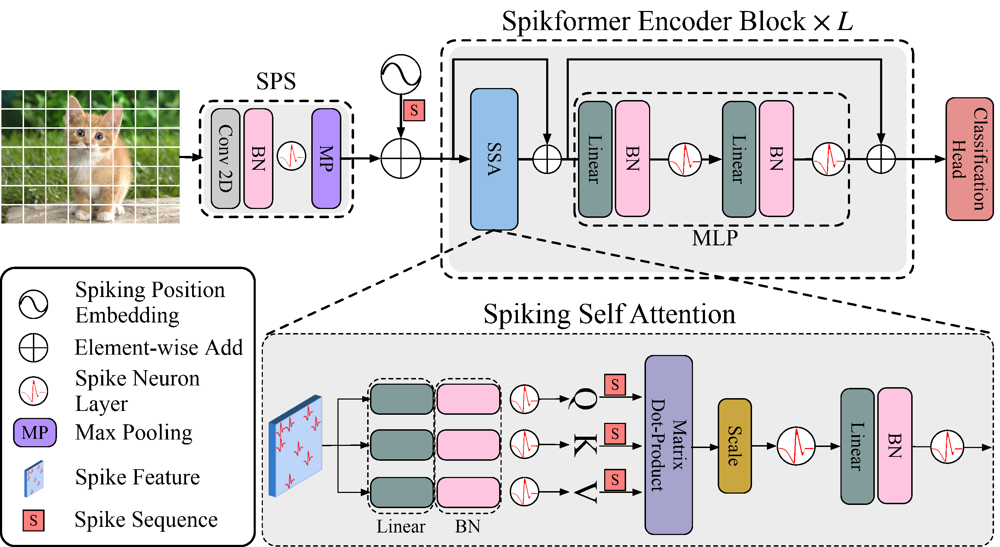
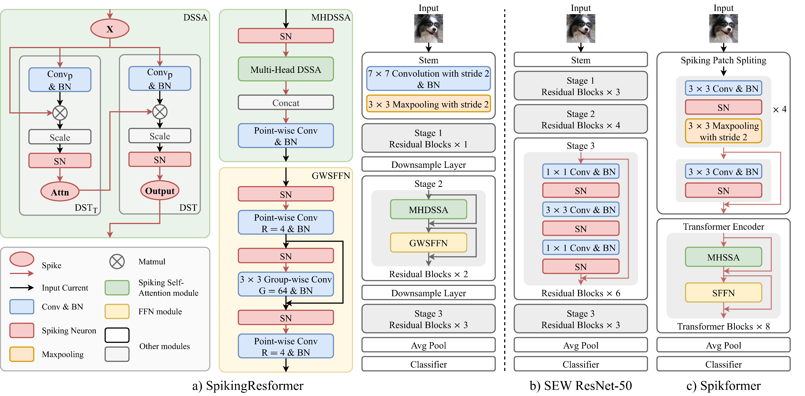

脉冲Transformer构建、训练和改进
=======================================

本教程作者： `周昭坤 <https://github.com/ZK-Zhou>`_ , `黄一凡 (AllenYolk) <https://github.com/AllenYolk>`_

English version: :doc:`../en/spikformer`

本教程介绍如何用 SpikingJelly 构建 Spikformer [#spikformer]_ 并改进 SSA 实现。Spikformer 的结构由三个主要组件组成：脉冲块分割前馈模块（Spiking Patch Splitting，SPS）、脉冲自注意力机制（Spiking Self Attention，SSA）和多层感知模块（Multi-Layer Perceptron，MLP），堆叠方式是一个 SPS 加若干个 SSA-MLP 组合块。训练流程见 :doc:`./train_large_scale_snn`；Spikformer 的分布式训练配置见 :doc:`./distributed_training`。具体的 SSA 和 Spikformer 如图所示：

构建脉冲Transformer
-----------------------------------

首先导入相关的模块：

.. code-block:: python

    import torch
    import torch.nn as nn
    import numpy as np
    from spikingjelly.activation_based import neuron

脉冲自注意力机制的Query、Key和Value均为脉冲序列，具体做法是在三个张量输出时添加脉冲神经元，耦合脉冲神经元来避免引入负值，取消了Softmax函数，构建脉冲自注意力机制：

.. code-block:: python

    class SSA(nn.Module):
        def __init__(self, dim, num_heads=8):
            super().__init__()
            assert dim % num_heads == 0, f"dim {dim} should be divided by num_heads {num_heads}."
            self.dim = dim
            self.num_heads = num_heads
            self.scale = 0.125

            self.q_linear = nn.Linear(dim, dim)
            self.q_bn = nn.BatchNorm1d(dim)
            self.q_lif = neuron.LIFNode(step_mode="m", detach_reset=True)

            self.k_linear = nn.Linear(dim, dim)
            self.k_bn = nn.BatchNorm1d(dim)
            self.k_lif = neuron.LIFNode(step_mode="m", detach_reset=True)

            self.v_linear = nn.Linear(dim, dim)
            self.v_bn = nn.BatchNorm1d(dim)
            self.v_lif = neuron.LIFNode(step_mode="m", detach_reset=True)

            self.attn_lif = neuron.LIFNode(step_mode="m", v_threshold=0.5, detach_reset=True)

            self.proj_linear = nn.Linear(dim, dim)
            self.proj_bn = nn.BatchNorm1d(dim)
            self.proj_lif = neuron.LIFNode(step_mode="m", detach_reset=True)

        def forward(self, x):
            T,B,N,C = x.shape

            x_for_qkv = x.flatten(0, 1)  # TB, N, C
            q_linear_out = self.q_linear(x_for_qkv)  # [TB, N, C]
            q_linear_out = self.q_bn(q_linear_out. transpose(-1, -2)).transpose(-1, -2).reshape(T, B, N, C).contiguous()
            q_linear_out = self.q_lif(q_linear_out)
            q = q_linear_out.reshape(T, B, N, self.num_heads, C//self.num_heads).permute(0, 1, 3, 2, 4).contiguous()

            k_linear_out = self.k_linear(x_for_qkv)
            k_linear_out = self.k_bn(k_linear_out. transpose(-1, -2)).transpose(-1, -2).reshape(T, B, N, C).contiguous()
            k_linear_out = self.k_lif(k_linear_out)
            k = k_linear_out.reshape(T, B, N, self.num_heads, C//self.num_heads).permute(0, 1, 3, 2, 4).contiguous()

            v_linear_out = self.v_linear(x_for_qkv)
            v_linear_out = self.v_bn(v_linear_out. transpose(-1, -2)).transpose(-1, -2).reshape(T, B, N, C).contiguous()
            v_linear_out = self.v_lif(v_linear_out)
            v = v_linear_out.reshape(T, B, N, self.num_heads, C//self.num_heads).permute(0, 1, 3, 2, 4).contiguous()

            attn = (q @ k.transpose(-2, -1)) * self.scale

            x = attn @ v
            x = x.transpose(2, 3).reshape(T, B, N, C).contiguous()
            x = self.attn_lif(x)
            x = x.flatten(0, 1)
            x = self.proj_lif(self.proj_bn(self.proj_linear(x).transpose(-1, -2)).transpose(-1, -2).reshape(T, B, N, C))

            return x

基于SSA和MLP构建脉冲Transformer的Block。下面的片段是结构示意：``MLP`` 代表通道在后的脉冲前馈模块，本页不定义它，因此该片段本身不可运行。SpikingJelly 提供 :class:`spikingjelly.activation_based.model.spikformer.SpikformerMLP` ，但它是 token-last 格式且需要 ``out_features`` 参数，不能直接替换下面的调用。注意此处使用SEW形式残差，若使用MS形式残差则需在SSA和MLP中更改脉冲神经元的位置：

.. code-block:: python

    class Block(nn.Module):
        def __init__(self, dim, num_heads, mlp_ratio=4.):
            super().__init__()
            self.attn = SSA(dim, num_heads=num_heads)
            mlp_hidden_dim = int(dim * mlp_ratio)
            self.mlp = MLP(in_features=dim, hidden_features=mlp_hidden_dim, out_features=dim)

        def forward(self, x):
            x = x + self.attn(x)
            x = x + self.mlp(x)
            return x

最后加入前馈模块，组成Spikformer。包含 patch splitting、上述 block 和读出层的完整模型由 :func:`spikingjelly.activation_based.model.spikformer.spikformer_ti` 提供：

.. code-block:: python

    from spikingjelly.activation_based.model.spikformer import spikformer_ti
    from spikingjelly.activation_based import functional

    net = spikformer_ti(T=4, img_size_h=32, img_size_w=32, num_classes=10)
    functional.set_step_mode(net, 'm')
    x_seq = torch.rand([4, 2, 3, 32, 32])
    y_seq = net(x_seq)
    print(f'y_seq.shape={y_seq.shape}')
    functional.reset_net(net)

``spikformer_ti`` 是 tiny 配置。``spikformer_s`` 和 ``spikformer_cifar10`` 分别提供 small ImageNet 和 CIFAR-10 配置及其训练默认参数。

读者还可以根据处理任务的分辨率和复杂性设计分层的Spikformer，参考QKformer。

SSA实现方式改进
-----------------------

SpikingJelly ``0.0.0.1.0`` 提供了 SSA 的高效实现 :class:`SpikingSelfAttention <spikingjelly.activation_based.layer.attention.SpikingSelfAttention>` 。
相比上一节中的 ``SSA``， :class:`SpikingSelfAttention <spikingjelly.activation_based.layer.attention.SpikingSelfAttention>` 从以下方向做出改进。

#. 假设输入和输出的形状是 ``[T, B, C, N]`` ，而非 ``[T, B, N, C]`` （ **token-last** ， 而非 channel-last ）。使用 ``Conv1d``，而非 ``Linear`` 。如此一来， ``BatchNorm1d`` 的前后无需转置。
#. 将 Q，K，V 的三组 Conv-BN-LIF 合并成一组，其 channel 数为原本的 3 倍。如此一来，可以一次性生成 ``q, k, v`` 三组张量。
#. 修改张量乘法的顺序。原本的实现中， ``q, k, v`` 形状均为 ``[T, B, N, C]`` ，所做的张量乘法为 ``q @ k.transpose(-2, -1) @ v``。改进后的实现中， ``q, k, v`` 的形状均为 ``[T, B, C, N]`` ，所做张量乘法变为 ``v @ k.transpose(-2, -1) @ q`` 。

.. note::

    记原始形如 ``[T, B, N, C]`` 的 ``q, k, v`` 张量为 :math:`Q, K, V` 。则 SSA 中张量乘法（即：批量矩阵乘法）可表示为：

    .. math::

        X = Q K^T V ,

    其中 :math:`K^T` 代表对 :math:`K` 的最后两个维度做转置。改进后的 ``q, k, v`` 以及张量乘法所得的 ``x`` 都形如 ``[T, B, C, N]``，相当于 :math:`Q^T, K^T, V^T, X^T`。记这些 token-last 的张量为 :math:`Q', K', V', X'` ，则有

    .. math::

        X' &= X^T \\
           &= (Q K^T V)^T \\
           &= V^T K Q^T \\
           &= V' K'^T Q' .

    所以对于改进后的 token-last 张量而言，张量乘法顺序应为 ``v @ k.transpose(-2, -1) @ q`` 。

下面的实现展示上述改动。完整实现见 :class:`SpikingSelfAttention <spikingjelly.activation_based.layer.attention.SpikingSelfAttention>` 的文档与源码。

.. code:: python

    from spikingjelly.activation_based.layer import SeqToANNContainer

    class SpikingSelfAttention(nn.Module):
        def __init__(self, dim, num_heads=8):
            super().__init__()
            assert dim % num_heads == 0, f"dim {dim} should be divided by num_heads {num_heads}."
            self.dim = dim
            self.num_heads = num_heads
            self.head_dim = dim // num_heads
            self.scale = 0.125

            self.qkv_conv_bn = SeqToANNContainer(
                nn.Conv1d(dim, dim * 3, kernel_size=1, stride=1, bias=False),
                nn.BatchNorm1d(dim*3),
            )
            self.qkv_lif = neuron.LIFNode(step_mode="m", detach_reset=True)

            self.attn_lif = neuron.LIFNode(step_mode="m", v_threshold=0.5, detach_reset=True)

            self.proj_conv_bn = SeqToANNContainer(
                nn.Conv1d(dim, dim, kernel_size=1, stride=1, bias=False),
                nn.BatchNorm1d(dim),
            )
            self.proj_lif = neuron.LIFNode(step_mode="m", detach_reset=True)

        def forward(self, x_seq: torch.Tensor):
            T, B, C, N = x_seq.shape

            qkv = self.qkv_conv_bn(x_seq)
            qkv = self.qkv_lif(qkv) # [T, B, 3*C, N]
            qkv = qkv.reshape(T, B, 3*self.num_heads, C // self.num_heads, N)

            qt, kt, vt = qkv.chunk(3, dim=2)
            # qt, kt, vt.shape = [T, B, NUM_HEADS, Cph, N]
            x_seq = vt @ kt.transpose(-2, -1)
            x_seq = (x_seq@qt) * self.scale # [T, B, NUM_HEADS, Cph, N]

            x_seq = self.attn_lif(x_seq).reshape(T, B, C, N)

            x_seq = self.proj_conv_bn(x_seq)
            x_seq = self.proj_lif(x_seq) # [T, B, C, N]
            return x_seq

.. note::

    使用 token-last 张量格式后，``MLP`` 的实现方式也应从 ``Linear`` 改为 ``Conv1d``，以避免不必要的涉及数据复制的 ``reshape`` 操作。

改进脉冲Transformer
-------------------------------
脉冲自注意力机制的建模形式尚处于开放探索阶段，已有多种改进，改进点的具体位置有：改进QKV的形式和计算方式，增强QKV的时空关注能力，设计脉冲位置编码和SSA分块加速等。
也可以改进脉冲 Transformer 中的 MLP 和 SPS 前馈模块。
Spikformer 的一个变体是 SpikingResformer [#spikingresformer]_ ，如下图：

.. [#spikformer] Zhou Zhaokun, Zhu Yuesheng, He Chao, Wang Yaowei, Yan Shuicheng, Tian Yonghong, Yuan Li. Spikformer: When Spiking Neural Network Meets Transformer [C]. Proceedings of International Conference on Learning Representations, 2023.
.. [#spikingresformer] Shi Xinyu, Hao Zecheng, Yu Zhaofei. SpikingResformer: Bridging ResNet and Vision Transformer in Spiking Neural Networks [C]. Proceedings of the IEEE/CVF Conference on Computer Vision and Pattern Recognition, 2024: 5610-5619.
