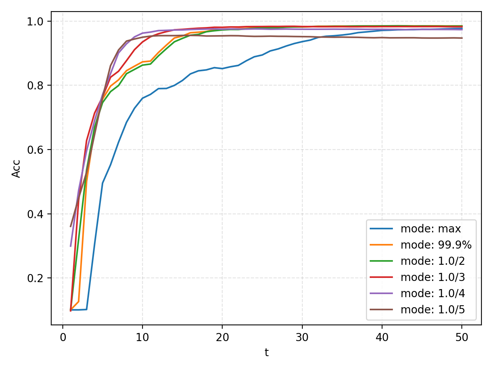

ANN2SNN
=======================================

Author: `DingJianhao <https://github.com/DingJianhao>`_, `fangwei123456 <https://github.com/fangwei123456>`_, `Lv Liuzhenghao <https://github.com/Lyu6PosHao>`_, `Yifan Huang (AllenYolk) <https://github.com/AllenYolk>`_

中文版：:doc:`../cn/ann2snn`

.. admonition:: ANN2SNN tutorial map

    Choose a conversion workflow for your model:

    #. For rate-coded CNN conversion, use the FX graph Recipe API: ``RateCodingRecipe`` / ``LocalThresholdBalancingRecipe`` define the algorithm, and ``FXConverter`` executes it (``Converter`` is the compatibility name).
    #. :doc:`Transformer ANN2SNN conversion <ann2snn_transformer>` covers ``STATransformerRecipe``, ``SpikeZIPTFQANNRecipe``, and offline multi-step ``Qwen2SNNRecipe`` conversion.

    For older ANN2SNN APIs, see the `0.0.0.0.14 documentation <https://spikingjelly.readthedocs.io/zh_CN/0.0.0.0.14/#index-en>`_.

You will train a small MNIST classifier, convert its ReLU activations to spiking neurons with ``spikingjelly.activation_based.ann2snn``, and accumulate its outputs over time to classify images.

See :mod:`spikingjelly.activation_based.ann2snn` for API references.

The rate-coding path uses ``torch.fx``. ``torch.fx`` traces ``nn.Module`` instances into a graph representation, which is then transformed by ANN2SNN FX recipes. ANN2SNN also provides ``ModuleConverter`` for conversions that directly replace an ``nn.Module`` tree without FX tracing, such as SpikeZIP and Qwen2; see the Transformer ANN2SNN tutorial for those paths.

Theoretical basis of ANN2SNN
----------------------------

SNNs communicate with discrete spikes, which enables efficient event-driven computation, but direct SNN training often requires more resources than ANN training. One approach is to train an ANN first, then convert it to an SNN with similar behavior. Rate coding represents activations through spike counts over time. In the classifier below, the final linear layer produces analog scores; sum those scores over time to select a class. Conversion relies on a spiking neuron's firing rate approximating an ANN neuron's activation.

ReLU activations in ANNs are strongly related to the firing rates of IF neurons with subtractive reset, where the membrane voltage is reset by subtracting :math:`V_{threshold}`. This neuron update method is the Soft reset method described in the `Neuron tutorial <https://spikingjelly.readthedocs.io/zh_CN/latest/tutorials/en/neuron.html>`_. ``RateCodingRecipe`` uses this relationship for conversion.

Experiment: Relationship between IF neuron spiking frequency and input
^^^^^^^^^^^^^^^^^^^^^^^^^^^^^^^^^^^^^^^^^^^^^^^^^^^^^^^^^^^^^^^^^^^^^^

Apply constant input to an IF neuron and observe its output spikes and firing rate. First import the modules, create an IF neuron layer, and plot the input :math:`x_{i}` for each neuron:

.. code-block:: python

    import torch
    from spikingjelly.activation_based import neuron
    from spikingjelly import visualizing
    from matplotlib import pyplot as plt
    import numpy as np

    plt.rcParams['figure.dpi'] = 200
    if_node = neuron.IFNode(v_reset=None)
    T = 128
    x = torch.arange(-0.2, 1.2, 0.04)
    plt.scatter(torch.arange(x.shape[0]), x)
    plt.title('Input $x_{i}$ to IF neurons')
    plt.xlabel('Neuron index $i$')
    plt.ylabel('Input $x_{i}$')
    plt.grid(linestyle='-.')
    plt.show()

.. image:: ../../_static/tutorials/5_ann2snn/0.*
    :width: 100%

Send the input to the IF neuron layer for ``T=128`` steps and observe the output spikes and firing rates:

.. code-block:: python

    s_list = []
    for t in range(T):
        s_list.append(if_node(x).unsqueeze(0))

    out_spikes = np.asarray(torch.cat(s_list))
    visualizing.plot_1d_spikes(out_spikes, 'IF neurons\' spikes and firing rates', 't', 'Neuron index $i$')
    plt.show()

.. image:: ../../_static/tutorials/5_ann2snn/1.*
    :width: 100%

Within a certain range, the firing frequency is proportional to the input :math:`x_{i}`.

Plot the firing rate against the input :math:`x_{i}` and compare it with :math:`\mathrm{ReLU}(x_{i})`:

.. code-block:: python

    plt.subplot(1, 2, 1)
    firing_rate = np.mean(out_spikes, axis=0)
    plt.plot(x, firing_rate)
    plt.title('Input $x_{i}$ and firing rate')
    plt.xlabel('Input $x_{i}$')
    plt.ylabel('Firing rate')
    plt.grid(linestyle='-.')

    plt.subplot(1, 2, 2)
    plt.plot(x, x.relu())
    plt.title('Input $x_{i}$ and ReLU($x_{i}$)')
    plt.xlabel('Input $x_{i}$')
    plt.ylabel('ReLU($x_{i}$)')
    plt.grid(linestyle='-.')
    plt.show()

.. image:: ../../_static/tutorials/5_ann2snn/2.*
    :width: 100%

The two curves are nearly identical. However, the firing rate cannot exceed 1, so the IF neuron cannot approximate ReLU activations larger than 1.

Theoretical proof
^^^^^^^^^^^^^^^^^

Literature [#f1]_ shows that, for constant input in ``[0, V_threshold]``, the firing rate of an IF neuron with subtractive reset approaches the normalized ReLU activation as T increases.

Consider the first layer. Let the firing rate of SNN neurons be :math:`r` and the corresponding ANN activation be :math:`a`. Assume constant input :math:`z \in [0,V_{threshold}]`. For an IF neuron with subtractive reset, the membrane potential evolves as:

.. math::
    V_t=V_{t-1}+z-V_{threshold}\theta_t

where :math:`V_{threshold}` is the firing threshold (usually 1.0) and :math:`\theta_t` is the output spike. The average firing rate over :math:`T` steps can be derived by summing the membrane potential:

.. math::
    \sum_{t=1}^{T} V_t= \sum_{t=1}^{T} V_{t-1}+z T-V_{threshold} \sum_{t=1}^{T}\theta_t

Rearranging the :math:`V_t` terms and dividing by :math:`T`:

.. math::
    \frac{V_T-V_0}{T} = z - V_{threshold}  \frac{\sum_{t=1}^{T}\theta_t}{T} = z- V_{threshold}  \frac{N}{T}

where :math:`N` is the spike count in the time window :math:`T`, and :math:`\frac{N}{T}` is the firing rate :math:`r`. Substituting :math:`z = V_{threshold} a`:

.. math::
    r = a- \frac{ V_T-V_0 }{T V_{threshold}}

Therefore, as the number of simulation steps :math:`T` tends to infinity:

.. math::
    r = a, \qquad 0 \leq a \leq 1

For higher layers, [#f1]_ shows that the inter-layer firing rate satisfies:

.. math::
    r^l = W^l r^{l-1}+b^l- \frac{V^l_T}{T V_{threshold}}

See [#f1]_ for the full derivation. The methods in ann2snn are based on [#f1]_.

Converting to spiking neural network
^^^^^^^^^^^^^^^^^^^^^^^^^^^^^^^^^^^^^

Conversion addresses two problems:

1. In evaluation mode, BatchNorm with available running mean and variance is a fixed affine transformation that can be folded into the preceding convolution, removing the separate BN module after conversion. ``RateCodingRecipe`` switches the model to eval before fusion. BN with ``track_running_stats=False`` cannot be folded by this path.

2. To represent a nonnegative ReLU activation with a binary neuron's firing rate, scale it into [0, 1] (model normalization). A percentile-based scale can leave outliers above this range, where firing saturates.

BatchNorm parameter absorption

Assume that the parameters of BatchNorm are: :math:`\gamma` (``BatchNorm.weight``), :math:`\beta` (``BatchNorm.bias``), :math:`\mu` (``BatchNorm.running_mean``) ,
:math:`\sigma` (including the numerical stability term ``eps``, :math:`\sigma = \sqrt{\mathrm{running\_var} + \mathrm{eps}}`). For specific parameter definitions, see
`torch.nn.BatchNorm1d <https://pytorch.org/docs/stable/generated/torch.nn.BatchNorm1d.html#torch.nn.BatchNorm1d>`_ . A convolutional layer has weight :math:`W` and bias :math:`b`. BatchNorm absorption folds the BatchNorm parameters into :math:`W` and :math:`b` so the new module produces the same output as the original module-plus-BatchNorm pair. The resulting :math:`\bar{W}` and :math:`\bar{b}` are:

.. math::
    \bar{W} = \frac{\gamma}{\sigma} W

.. math::
    \bar{b} = \frac{\gamma}{\sigma} (b - \mu) + \beta

Model Normalization

For a parameter module with input tensor maximum :math:`\lambda_{pre}` and output tensor maximum :math:`\lambda`, the normalized weight :math:`\hat{W}` is:

.. math::
     \hat{W} = W * \frac{\lambda_{pre}}{\lambda}

The normalized bias :math:`\hat{b}` is:

.. math::
     \hat{b} = \frac{b}{\lambda}

Layer activations often contain large outliers that suppress the overall firing rate. Robust normalization replaces the tensor maximum with the p-quantile as the scaling factor. The recommended quantile is 99.9% [#f1]_.

The recipe fuses BatchNorm before calibration, then replaces ReLU with a scaling-and-IF group. Average pooling keeps its spatial downsampling behavior. Use ``AvgPool2d`` in your first model. For a matched ReLU-MaxPool pair, ``channel_wise=True, pre_spike_maxpool=True`` moves pooling before the spike neuron; this is different from the momentum-based spike gating in [#f1]_. During simulation, feed the same analog input at every time step. Poisson encoding adds sampling noise and can reduce accuracy.

Implementation and optional configuration
^^^^^^^^^^^^^^^^^^^^^^^^^^^^^^^^^^^^^^^^^^^^^^^^

A recipe defines the conversion algorithm; a converter applies it to your model. For rate-coded CNNs, use the FX path:

* ``FXConversionRecipe`` owns algorithm-specific options and graph transformations. The compatibility name ``ConversionRecipe`` is equivalent to ``FXConversionRecipe``.
* ``FXConverter`` is the executor. The compatibility name ``Converter`` is equivalent to ``FXConverter``. It receives an FX recipe, traces the model with ``torch.fx``, and calls the FX recipe steps through ``convert(model)``.
* Direct ``nn.Module`` tree conversion uses ``ModuleConversionRecipe`` and ``ModuleConverter``. It does not run FX tracing, and ``Converter`` does not automatically dispatch to it.

For ReLU-to-IFNode rate-coding conversion, use ``RateCodingRecipe``. It needs a calibration dataloader because it measures activation ranges before replacing ReLU modules. The common normalization modes are:

* ``mode="max"``: MaxNorm, which uses maximum activation values [#f2]_.
* ``mode="99.9%"``: RobustNorm, which uses the 99.9% activation quantile [#f1]_.
* ``mode`` as a float in ``(0, 1]``: scale the maximum activation by this value.

The statistics are computed per batch and combined with an exponential moving average (``momentum=0.1`` by default). Keep calibration order fixed when comparing recipes.

``RateCodingRecipe`` also owns options such as ``fuse_flag``. When ``fuse_flag=True`` (the default), Conv-BatchNorm pairs are fused before calibration.

Start with a small untrained ANN and one calibration batch to try the API:

.. code-block:: python

    import torch
    from torch import nn
    from spikingjelly.activation_based import ann2snn

    x = torch.rand(2, 4)
    T = 16
    ann = nn.Sequential(nn.Linear(4, 8), nn.ReLU(), nn.Linear(8, 2)).eval()
    train_loader = [x]
    recipe = ann2snn.RateCodingRecipe(dataloader=train_loader, mode="max")
    snn = ann2snn.FXConverter(recipe=recipe).convert(ann)

Step-mode execution follows the same convention as other ``spikingjelly.activation_based`` modules. In single-step mode, users write the time loop explicitly. Rate-coding and LTB models receive the same static ANN input at each timestep:

.. code-block:: python

    from spikingjelly.activation_based import functional

    functional.set_step_mode(snn, "s")
    functional.reset_net(snn)

    with torch.no_grad():
        y = None
        for t in range(T):
            y_t = snn(x)
            y = y_t if y is None else y + y_t

To run the layer-wise multi-step path, pass a sequence whose first dimension is time and then perform the accumulated readout explicitly:

.. code-block:: python

    functional.set_step_mode(snn, "m")
    functional.reset_net(snn)

    x_seq = x.unsqueeze(0).expand(T, *x.shape)
    with torch.no_grad():
        y_seq = snn(x_seq)
        y = y_seq.sum(dim=0)

After conversion, ReLU modules are removed. New modules needed by the SNN, such as ``VoltageScaler`` and ``IFNode``, are created as ``spiking_*`` submodules under the original parent module. With ``RateCodingRecipe``, the converted model is an ``fx.GraphModule``, so you can use ``snn.graph.print_tabular()`` to inspect the generated computation graph. More APIs are documented in `GraphModule <https://pytorch.org/docs/stable/fx.html?highlight=graphmodule#torch.fx.GraphModule>`_ .

.. note::

    Pass a recipe instance to ``FXConverter(recipe=...)``, then call ``convert(model)``. The string alias ``"transformer_td_equivalent"`` is also accepted. Rate-coding and STA require recipe instances with their calibration settings; module-tree recipes require ``ModuleConverter``.

Classify MNIST
--------------

Build and train the ANN
^^^^^^^^^^^^^^^^^^^^^^^

Build a convolutional ANN to classify MNIST digits, then convert it with ``ann2snn``.

The complete runnable example is ``spikingjelly.activation_based.ann2snn.examples.cnn_mnist``. The network structure is defined in ``ann2snn.sample_models.mnist_cnn``:

.. code-block:: python

    import torch
    import torch.nn as nn

    class CNN(nn.Module):
        def __init__(self):
            super().__init__()
            self.network = nn.Sequential(
                nn.Conv2d(1, 32, 3, 1),
                nn.BatchNorm2d(32),
                nn.ReLU(),
                nn.AvgPool2d(2, 2),

                nn.Conv2d(32, 32, 3, 1),
                nn.BatchNorm2d(32),
                nn.ReLU(),
                nn.AvgPool2d(2, 2),

                nn.Conv2d(32, 32, 3, 1),
                nn.BatchNorm2d(32),
                nn.ReLU(),
                nn.AvgPool2d(2, 2),

                nn.Flatten(),
                nn.Linear(32, 10),
            )

        def forward(self, x):
            x = self.network(x)
            return x

To flatten a tensor, define ``nn.Flatten`` and call it in ``forward``; this lets the converter distinguish the time dimension from feature dimensions.

Set the runtime options:

.. code-block:: python

    torch.random.manual_seed(0)
    if torch.cuda.is_available():
        torch.cuda.manual_seed(0)
    device = "cuda" if torch.cuda.is_available() else "cpu"
    dataset_dir = "./data/mnist"
    batch_size = 100
    T = 50

``T`` is the number of SNN simulation steps used during inference. Create the MNIST dataloaders before conversion:

.. code-block:: python

    import torchvision

    train_data_dataset = torchvision.datasets.MNIST(
        root=dataset_dir,
        train=True,
        transform=torchvision.transforms.ToTensor(),
        download=True,
    )
    train_data_loader = torch.utils.data.DataLoader(
        dataset=train_data_dataset, batch_size=batch_size, shuffle=True, drop_last=False
    )
    calibration_data_loader = torch.utils.data.DataLoader(
        dataset=train_data_dataset, batch_size=batch_size, shuffle=False, drop_last=False
    )
    test_data_dataset = torchvision.datasets.MNIST(
        root=dataset_dir,
        train=False,
        transform=torchvision.transforms.ToTensor(),
        download=True,
    )
    test_data_loader = torch.utils.data.DataLoader(
        dataset=test_data_dataset, batch_size=50, shuffle=True, drop_last=False
    )

Train the ANN, save its weights, and check its accuracy. You can also use the `pretrained weights <https://ndownloader.figshare.com/files/34960191>`_:

.. code-block:: python

    from spikingjelly.activation_based.ann2snn.examples.cnn_mnist import (
        DEFAULT_CHECKPOINT_PATH,
        val,
    )
    from spikingjelly.activation_based.ann2snn.sample_models import mnist_cnn

    model = mnist_cnn.CNN().to(device)
    loss_function = torch.nn.CrossEntropyLoss()
    optimizer = torch.optim.Adam(model.parameters(), lr=1e-3, weight_decay=5e-4)
    model.train()
    for epoch in range(10):
        for img, label in train_data_loader:
            optimizer.zero_grad()
            loss = loss_function(model(img.to(device)), label.to(device))
            loss.backward()
            optimizer.step()
    torch.save(model.state_dict(), DEFAULT_CHECKPOINT_PATH)
    acc = val(model, device, test_data_loader)
    print('ANN Validating Accuracy: %.4f' % (acc))

Reference output with the original pretrained weights:

.. code-block:: shell

    ANN Validating Accuracy: 0.9870

Make the conversion with the converter
^^^^^^^^^^^^^^^^^^^^^^^^^^^^^^^^^^^^^^^^^^

The ANN is trained and validated. Select the rate-coding recipe, pass the deterministic calibration dataloader, and run ``Converter`` to execute the conversion:

.. code-block:: python

    from spikingjelly.activation_based import ann2snn

    recipe = ann2snn.RateCodingRecipe(dataloader=calibration_data_loader, mode="max")
    model_converter = ann2snn.FXConverter(recipe=recipe)
    snn_model = model_converter.convert(model)

``snn_model`` is the converted SNN model. The ``BatchNorm2d`` modules have disappeared because the default rate-coding recipe fuses BatchNorm parameters into the preceding Conv layers before calibration:

.. code-block:: text

    GraphModule(
      (network): Module(
        (0): Conv2d(1, 32, kernel_size=(3, 3), stride=(1, 1), step_mode=s)
        ...
        (spiking_0): Module(
          (scaler0): VoltageScaler(0.193247, step_mode=s)
          (if_node): IFNode(
            v_threshold=1.0, v_reset=None, detach_reset=False, step_mode=s
            (surrogate_function): Sigmoid(alpha=4.0, spiking=True)
          )
          (scaler1): VoltageScaler(5.174733, step_mode=s)
        )
        ...
      )
    )

The scale values depend on your trained weights and calibration batches. Each calibrated ReLU is replaced by one such ``scaler0 -> IFNode -> scaler1`` group.

Other recipes and custom recipes
^^^^^^^^^^^^^^^^^^^^^^^^^^^^^^^^

The MNIST example above uses rate coding to convert ReLU activations to IF neurons. Transformer models can use ``TransformerTDEquivalentRecipe`` instead:

.. code-block:: python

    import torch.nn as nn
    from spikingjelly.activation_based import ann2snn

    transformer_ann = nn.Sequential(nn.Linear(4, 8), nn.GELU(), nn.Linear(8, 2)).eval()
    recipe = ann2snn.TransformerTDEquivalentRecipe()
    td_model = ann2snn.FXConverter(recipe=recipe).convert(transformer_ann)

This recipe does not need a dataloader, does not insert ``VoltageHook``, and does not run rate-coding calibration. It replaces currently supported ANN modules and attention calls with TD-equivalent operators, but does not cover fully spike-driven LLM conversion. In these TD operators, ``ann_forward(...)`` is the ordinary stateless PyTorch path; ``single_step_forward(...)`` is a stateful temporal-difference step and should be reset before an independent sequence.

To add a new FX graph conversion algorithm, subclass ``FXConversionRecipe`` (or the compatibility name ``ConversionRecipe``) and override only the steps you need. Unoverridden methods use the base no-op implementation. A recipe is not an executor and should not provide ``convert()``, ``run()``, or ``__call__()``:

.. code-block:: python

    class MyFXRecipe(ann2snn.FXConversionRecipe):
        def replace(self, converter, fx_model):
            # Implement the algorithm-specific graph rewrite here.
            return fx_model

The fixed FX step order is ``validate`` -> ``before_trace`` -> ``after_trace`` -> ``insert_observers`` -> ``calibrate`` -> ``replace`` -> ``finalize``.

If an algorithm does not need an FX graph and directly replaces an ``nn.Module`` tree, subclass ``ModuleConversionRecipe`` and execute it with ``ModuleConverter``. This path has only ``validate`` -> ``convert_module`` and has no ``before_trace`` or ``finalize``:

.. code-block:: python

    class MyModuleRecipe(ann2snn.ModuleConversionRecipe):
        def convert_module(self, converter, ann):
            # Replace submodules in ann or return a converted copy.
            return ann

    converted = ann2snn.ModuleConverter(recipe=MyModuleRecipe()).convert(ann)

Rate-coding implementation
^^^^^^^^^^^^^^^^^^^^^^^^^^

With default scalar calibration, ``RateCodingRecipe`` matches exact ``nn.ReLU`` modules, calibrates
them with ``VoltageHook``, and replaces each activation with
``VoltageScaler(1 / s) -> IFNode -> VoltageScaler(s)``. To customize neuron
construction, pass ``neuron_factory=lambda scale: ...``; the callable receives
the calibrated layer scale. A different activation or conversion algorithm
should be implemented as a separate recipe.

Comparison of different converting modes
^^^^^^^^^^^^^^^^^^^^^^^^^^^^^^^^^^^^^^^^^^^^^

Compare accuracy over time for the normalization modes in ``RateCodingRecipe`` with ``--plot-mode-sweep``:

.. code-block:: shell

    python -m spikingjelly.activation_based.ann2snn.examples.cnn_mnist \
      --time-steps 50 \
      --plot-mode-sweep

Reference results (commit `237dde3e <https://github.com/fangwei123456/spikingjelly/commit/237dde3e>`_, NVIDIA GeForce RTX 4090, ``T=50``, ANN validation accuracy 0.9870):

.. list-table:: Normalization mode comparison
    :header-rows: 1
    :widths: 34 20 20 26

    * - Mode
      - Calibration
      - Simulation
      - SNN accuracy
    * - MaxNorm
      - 3.76s
      - 7.61s
      - 0.9771
    * - RobustNorm
      - 12.08s
      - 7.31s
      - 0.9848
    * - 1/2 max(activation)
      - 3.73s
      - 7.28s
      - 0.9846
    * - 1/3 max(activation)
      - 3.72s
      - 7.29s
      - 0.9825
    * - 1/4 max(activation)
      - 3.75s
      - 7.27s
      - 0.9734
    * - 1/5 max(activation)
      - 3.70s
      - 7.26s
      - 0.9472

RobustNorm reached the highest final accuracy in this run. Scaling the maximum to 1/4 or 1/5 trades earlier convergence for final accuracies 1.14 and 3.76 percentage points below RobustNorm.

Conversion recipe comparison
^^^^^^^^^^^^^^^^^^^^^^^^^^^^

Besides the basic ``RateCodingRecipe``, SpikingJelly also provides ``LocalThresholdBalancingRecipe`` for estimating local thresholds during conversion. This recipe follows the local-threshold-balancing method [#f3]_. The following comparison uses the ANN, scalar-threshold RobustNorm, and the LTB recipe. Run ``spikingjelly.activation_based.ann2snn.examples.cnn_mnist``:

.. code-block:: shell

    python -m spikingjelly.activation_based.ann2snn.examples.cnn_mnist \
      --time-steps 32 \
      --output /tmp/ann2snn_mnist_t32.json

The command writes your results to ``/tmp/ann2snn_mnist_t32.json``. RobustNorm uses ``RateCodingRecipe(dataloader=..., mode="99.9%")``. LTB uses ``LocalThresholdBalancingRecipe(dataloader=...)``. This MNIST run uses all 60000 training samples for calibration and evaluates on the full 10000-image test set:

Reference results (commit `83b836be <https://github.com/fangwei123456/spikingjelly/commit/83b836be>`_):

.. list-table:: MNIST CNN conversion results
    :header-rows: 1
    :widths: 24 20 18 16 18

    * - Method
      - Calibration samples
      - Test samples
      - Timesteps
      - Top-1 (%)
    * - ANN
      - -
      - 10000
      - -
      - 98.70
    * - RobustNorm (scalar threshold)
      - 60000
      - 10000
      - 32
      - 98.35
    * - LocalThresholdBalancingRecipe
      - 60000
      - 10000
      - 32
      - 98.53

ResNet-18 conversion
--------------------

The ImageNet ResNet-18 example demonstrates the same recipes on a larger classification model. It uses torchvision ``ResNet18_Weights.IMAGENET1K_V1`` and the corresponding preprocessing. The calibration set is a deterministic 50000-image subset from ImageNet train, and the evaluation set is the full 50000-image ImageNet validation set. The command assumes that ``/path/to/imagenet`` contains ``train/`` and ``val/``. If your dataset is nested under an additional directory such as ``ILSVRC2012/``, point ``--data-root`` to the directory that directly contains ``train/`` and ``val/``.

.. note::

    ``LocalThresholdBalancingRecipe`` implements local threshold estimation inspired by [#f3]_. Its conversion and evaluation settings differ from the paper's full pipeline, so compare the results below with the ANN baseline from the same run.

Run the example as follows:

.. code-block:: shell

    CUDA_VISIBLE_DEVICES=0 python -m spikingjelly.activation_based.ann2snn.examples.imagenet_resnet18_ltb \
      --data-root /path/to/imagenet \
      --calib-samples 50000 \
      --batch-size 128 \
      --num-workers 8 \
      --device cuda:0 \
      --time-steps 32 \
      --recipes ann robust_legacy ltb \
      --delay-start auto \
      --output /tmp/ann2snn_imagenet_t32_delayauto_calib50k_tutorial.json

The ``robust_legacy`` recipe name denotes the scalar-threshold ``RateCodingRecipe`` without ``channel_wise`` or ``half_threshold``. ``--delay-start auto`` estimates the delayed-readout start timestep before evaluation and skips the early transient SNN timesteps. It only changes the readout window and does not change the converted neuron dynamics. In the full LTB run below, the estimated ``delay_start`` is 27; the exact value can vary with the model, calibration data, and implementation details.

Reference results (commit `33766fc7 <https://github.com/fangwei123456/spikingjelly/commit/33766fc7>`_):

.. list-table:: ImageNet ResNet-18 conversion results
    :header-rows: 1
    :widths: 30 18 18 14 16 16

    * - Method
      - Calibration samples
      - Validation samples
      - Timesteps
      - Top-1 (%)
      - Top-5 (%)
    * - ANN
      - -
      - 50000
      - -
      - 69.756
      - 89.074
    * - RobustNorm (scalar threshold)
      - 50000
      - 50000
      - 32
      - 12.462
      - 28.662
    * - LocalThresholdBalancingRecipe
      - 50000
      - 50000
      - 32
      - 65.472
      - 86.636

Scalar-threshold robust normalization without per-channel normalization achieves only 12.462% Top-1 on this deeper ImageNet CNN. The LTB recipe raises it to 65.472% Top-1.

.. [#f1] Rueckauer B, Lungu I-A, Hu Y, Pfeiffer M and Liu S-C (2017) Conversion of Continuous-Valued Deep Networks to Efficient Event-Driven Networks for Image Classification. Front. Neurosci. 11:682.
.. [#f2] Diehl, Peter U. , et al. Fast classifying, high-accuracy spiking deep networks through weight and threshold balancing. Neural Networks (IJCNN), 2015 International Joint Conference on IEEE, 2015.
.. [#f3] Bu T, Li M, Yu Z. Inference-Scale Complexity in ANN-SNN Conversion for High-Performance and Low-Power Applications. arXiv:2409.03368, 2024. Accepted by CVPR 2025.

Additional references:

* Rueckauer, B., Lungu, I. A., Hu, Y., & Pfeiffer, M. (2016). Theory and tools for the conversion of analog to spiking convolutional neural networks. arXiv preprint arXiv:1612.04052.
* Sengupta, A., Ye, Y., Wang, R., Liu, C., & Roy, K. (2019). Going deeper in spiking neural networks: Vgg and residual architectures. Frontiers in neuroscience, 13, 95.
