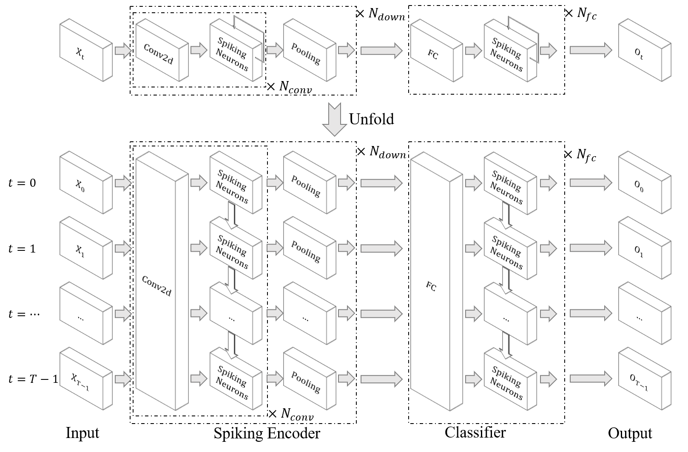

Classify DVS Gesture
=======================================
Author: `fangwei123456 <https://github.com/fangwei123456>`_

中文版： :doc:`../cn/classify_dvsg`

Translator: `Qiu Haonan <https://github.com/Maybe2022>`_, `fangwei123456 <https://github.com/fangwei123456>`_

You will feed the DVS128 Gesture frames created in :doc:`./neuromorphic_datasets` to a convolutional SNN and classify 11 gesture classes.

Network structure
-------------------------------------------
We will use the network defined in [#PLIF]_, which has the following structure:

All networks in [#PLIF]_ are defined in :class:`spikingjelly.activation_based.model.parametric_lif_net`. The network structure for DVS Gesture is:

.. code-block:: python

    # spikingjelly.activation_based.model.parametric_lif_net

    from copy import deepcopy

    import torch
    import torch.nn as nn
    from spikingjelly.activation_based import layer

    class DVSGestureNet(nn.Module):
        def __init__(self, channels=128, spiking_neuron: callable = None, **kwargs):
            super().__init__()

            conv = []
            for i in range(5):
                if not conv:
                    in_channels = 2
                else:
                    in_channels = channels

                conv.append(layer.Conv2d(in_channels, channels, kernel_size=3, padding=1, bias=False))
                conv.append(layer.BatchNorm2d(channels))
                conv.append(spiking_neuron(**deepcopy(kwargs)))
                conv.append(layer.MaxPool2d(2, 2))

            self.conv_fc = nn.Sequential(
                *conv,

                layer.Flatten(),
                layer.Dropout(0.5),
                layer.Linear(channels * 4 * 4, 512),
                spiking_neuron(**deepcopy(kwargs)),

                layer.Dropout(0.5),
                layer.Linear(512, 110),
                spiking_neuron(**deepcopy(kwargs)),

                layer.VotingLayer(10)
            )

        def forward(self, x: torch.Tensor):
            return self.conv_fc(x)

Train
-------------------------------------------
The training loop follows :doc:`./conv_fashion_mnist`. Change the dataset, input shape, and class count for DVS128 Gesture.

We use multi-step mode for faster training speed, and use automatic device-based neuron execution:

.. code-block:: python

    # spikingjelly.activation_based.examples.classify_dvsg

    import torch
    import sys
    import torch.nn.functional as F
    from torch.cuda import amp
    from spikingjelly.activation_based import functional, surrogate, neuron
    from spikingjelly.activation_based.model import parametric_lif_net
    from spikingjelly.datasets.dvs128_gesture import DVS128Gesture
    from torch.utils.data import DataLoader
    from torch.utils.tensorboard import SummaryWriter
    import time
    import os
    import argparse
    import datetime

    def main():
        # ...
        net = parametric_lif_net.DVSGestureNet(channels=args.channels, spiking_neuron=neuron.LIFNode, surrogate_function=surrogate.ATan(), detach_reset=True)

        functional.set_step_mode(net, 'm')
        # ...

Define the dataset:

.. code-block:: python

    # spikingjelly.activation_based.examples.classify_dvsg

    def main():
        # ...
        train_set = DVS128Gesture(root=args.data_dir, train=True, data_type='frame', frames_number=args.T, split_by='number')
        test_set = DVS128Gesture(root=args.data_dir, train=False, data_type='frame', frames_number=args.T, split_by='number')
        # ...

``DataLoader`` returns frames with shape ``[N, T, C, H, W]``, with the batch dimension first. Multi-step mode expects time first, so transpose the frames to ``[T, N, C, H, W]``:

.. code-block:: python

    # spikingjelly.activation_based.examples.classify_dvsg

    def main():
        # ...
        for epoch in range(start_epoch, args.epochs):
            for frame, label in train_data_loader:
                optimizer.zero_grad()
                frame = frame.to(args.device)
                frame = frame.transpose(0, 1)  # [N, T, C, H, W] -> [T, N, C, H, W]
                # ...

            with torch.no_grad():
                for frame, label in test_data_loader:
                    frame = frame.to(args.device)
                    frame = frame.transpose(0, 1)  # [N, T, C, H, W] -> [T, N, C, H, W]
                    # ...

        # ...

DVS128 Gesture has 11 classes, so set the one-hot target class count to 11:

.. code-block:: python

    # spikingjelly.activation_based.examples.classify_dvsg

    def main():
        # ...
        label_onehot = F.one_hot(label, 11).float()
        # ...

``DVSGestureNet`` outputs ``[T, N, 11]`` tensors. Its final ``VotingLayer`` averages each group of 10 neurons, so the per-step output is not binary. Averaging over time gives the classification scores.

.. code-block:: python

    # spikingjelly.activation_based.model.parametric_lif_net

    class DVSGestureNet(nn.Module):
        # ...
        def forward(self, x: torch.Tensor):
            return self.conv_fc(x)

Use the time-averaged classification scores to compute loss and accuracy:

.. code-block:: python

    # spikingjelly.activation_based.examples.classify_dvsg

    def main():
        # ...
        out_fr = net(frame).mean(0)
        loss = F.mse_loss(out_fr, label_onehot)
        # ...

Train the network:

.. code-block:: shell

    python -m spikingjelly.activation_based.examples.classify_dvsg -T 16 -device cuda:0 -b 16 -epochs 64 -data-dir /datasets/DVSGesture/ -amp -opt adam -lr 0.001 -j 8

Reference results (commit ``e38dee59``, CuPy backend): the highest test accuracy is ``0.9375``.

The accuracy curve from that run is:

.. image:: ../../_static/tutorials/classify_dvsg/dvsg_logs.*
    :width: 100%

.. [#PLIF] Fang, Wei, et al. "Incorporating learnable membrane time constant to enhance learning of spiking neural networks." Proceedings of the IEEE/CVF International Conference on Computer Vision (ICCV), 2021, pp. 2661-2671. `CVF <https://openaccess.thecvf.com/content/ICCV2021/html/Fang_Incorporating_Learnable_Membrane_Time_Constant_To_Enhance_Learning_of_Spiking_ICCV_2021_paper.html>`_
