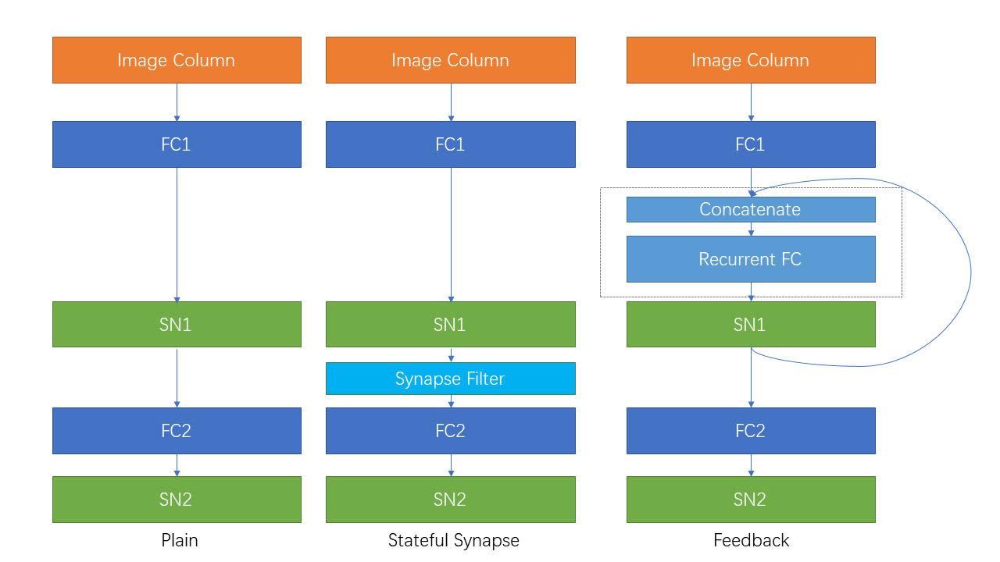

Recurrent Connection and Stateful Synapse
============================================

Author: `fangwei123456 <https://github.com/fangwei123456>`_

中文版： :doc:`../cn/recurrent_connection_and_stateful_synapse`

Self-connected Modules
-----------------------------
Recurrent connection is the connection from outputs to inputs, e.g., the SRNN(recurrent networks of spiking neurons) in [#Effective]_, which are shown in the following figure:

.. image:: ../../_static/tutorials/15_recurrent_connection_and_stateful_synapse/SRNN_example.*
    :width: 100%

You can feed a spiking layer's output back into its next input. For addition, the output :math:`s[t]` at time-step :math:`t` is added to the external input :math:`x[t+1]` as the next input. Use :class:`spikingjelly.activation_based.layer.ElementWiseRecurrentContainer` to implement this feedback.

:class:`ElementWiseRecurrentContainer <spikingjelly.activation_based.layer.ElementWiseRecurrentContainer>` wraps a ``sub_module`` whose input and output shapes match.

The connection can be specified as a user-defined element-wise operation :math:`z=f(y, x)`. Denote :math:`x[t]` as the external input for the whole module (container and ``sub_module``) at time-step :math:`t`, :math:`i[t]` and :math:`y[t]` are the input and output of ``sub_module`` \
(:math:`y[t]` is also the output of the whole module):

.. math::

    i[t] = f(y[t-1], x[t])

where :math:`f` is a user-defined element-wise function. We regard :math:`y[-1] = 0`.

Use ``ElementWiseRecurrentContainer`` to wrap one IF neuron. We set the element-wise function as addition:

.. math::

    i[t] = x[t] + y[t-1].

The external inputs are :math:`x[t]=[1.5, 0, ..., 0]`:

.. code-block:: python

    import torch
    from spikingjelly.activation_based import layer, functional, neuron

    T = 8
    N = 1

    def element_wise_add(y, x):
        return x + y

    net = layer.ElementWiseRecurrentContainer(neuron.IFNode(), element_wise_add)
    print(net)
    x = torch.zeros([T, N])
    x[0] = 1.5
    for t in range(T):
        print(t, f'x[t]={x[t]}, s[t]={net(x[t])}')

    functional.reset_net(net)

After the module description (whose function address varies), the spike outputs are:

.. code-block:: bash

    0 x[t]=tensor([1.5000]), s[t]=tensor([1.])
    1 x[t]=tensor([0.]), s[t]=tensor([1.])
    2 x[t]=tensor([0.]), s[t]=tensor([1.])
    3 x[t]=tensor([0.]), s[t]=tensor([1.])
    4 x[t]=tensor([0.]), s[t]=tensor([1.])
    5 x[t]=tensor([0.]), s[t]=tensor([1.])
    6 x[t]=tensor([0.]), s[t]=tensor([1.])
    7 x[t]=tensor([0.]), s[t]=tensor([1.])

We can find that even when :math:`t \ge 1`, :math:`x[t]=0`, the neuron can still fire spikes because of the recurrent connection.

We can use :class:`spikingjelly.activation_based.layer.LinearRecurrentContainer` to implement the more complex recurrent connection.

Stateful Synapse
-----------------------
Some papers, e.g., [#Unsupervised]_ and [#Exploiting]_ , use the stateful synapses. By placing :class:`spikingjelly.activation_based.layer.SynapseFilter` after the synapse to filter the output current, \
we can get the stateful synapse:

.. code-block:: python

    import torch
    import torch.nn as nn
    from spikingjelly.activation_based import layer, functional, neuron

    stateful_conv = nn.Sequential(
        layer.Conv2d(3, 16, kernel_size=3, padding=1, stride=1),
        layer.SynapseFilter(tau=100.)
    )

Experiments on Sequential FashionMNIST
------------------------------------------
You will compare three networks on Sequential FashionMNIST, where each image arrives one column at a time. The networks must retain information from earlier columns to classify the image:

.. image:: ../../_static/tutorials/recurrent_connection_and_stateful_synapse/samples/a.*
    :width: 50%

The following figure shows the column that is being sent:

.. image:: ../../_static/tutorials/recurrent_connection_and_stateful_synapse/samples/b.*
    :width: 50%

Import the modules needed to define and run the networks:

.. code:: python

    import torch
    import torch.nn as nn
    from spikingjelly.activation_based import neuron, surrogate, layer, functional

Define the plain feedforward network ``PlainNet``:

.. code:: python

    class PlainNet(nn.Module):
        def __init__(self):
            super().__init__()
            self.fc = nn.Sequential(
                layer.Linear(28, 32),
                neuron.IFNode(surrogate_function=surrogate.ATan()),
                layer.Linear(32, 10),
                neuron.IFNode(surrogate_function=surrogate.ATan())
            )

        def forward(self, x: torch.Tensor):
            return self.fc(x).mean(0)

By adding a :class:`spikingjelly.activation_based.layer.SynapseFilter` behind the first spiking neurons layer of ``PlainNet``, we can get the network ``StatefulSynapseNet``:

.. code:: python

    class StatefulSynapseNet(nn.Module):
        def __init__(self):
            super().__init__()
            self.fc = nn.Sequential(
                layer.Linear(28, 32),
                neuron.IFNode(surrogate_function=surrogate.ATan()),
                layer.SynapseFilter(tau=2., learnable=True),
                layer.Linear(32, 10),
                neuron.IFNode(surrogate_function=surrogate.ATan())
            )

        def forward(self, x: torch.Tensor):
            return self.fc(x).mean(0)

By adding a recurrent connection implemented by :class:`spikingjelly.activation_based.layer.LinearRecurrentContainer` to ``PlainNet``, we can get ``FeedBackNet``

.. code:: python

    class FeedBackNet(nn.Module):
        def __init__(self):
            super().__init__()

            self.fc = nn.Sequential(
                layer.Linear(28, 32),
                layer.LinearRecurrentContainer(
                    neuron.IFNode(surrogate_function=surrogate.ATan(), detach_reset=True),
                    in_features=32, out_features=32, bias=True
                ),
                layer.Linear(32, 10),
                neuron.IFNode(surrogate_function=surrogate.ATan())
            )

        def forward(self, x: torch.Tensor):
            return self.fc(x).mean(0)

The three networks read the image column by column, so the input is a sequence whose
time dimension is the image width. The same setup applies to all of them:

.. code:: python

    net = FeedBackNet()
    # 'functional.set_step_mode' will not set neurons in LinearRecurrentContainer to use step_mode = 'm'
    functional.set_step_mode(net, step_mode='m')
    img = torch.rand(2, 1, 28, 28)
    img = img.squeeze(1).permute(2, 0, 1)  # [N, 1, H, W] -> [W, N, H], regarded as [T, N, H]
    out_fr = net(img)
    print(out_fr.shape)  # torch.Size([2, 10])
    # the neurons of the SNN have "memory", so reset them between batches
    functional.reset_net(net)

The following figure shows the network structure of three networks:

The complete codes are saved in `spikingjelly.activation_based.examples.rsnn_sequential_fmnist <https://github.com/fangwei123456/spikingjelly/blob/master/spikingjelly/activation_based/examples/rsnn_sequential_fmnist.py>`_. We can run by the following commands:

.. code-block:: shell

    python -m spikingjelly.activation_based.examples.rsnn_sequential_fmnist --help

Train three networks:

.. code:: shell

    python -m spikingjelly.activation_based.examples.rsnn_sequential_fmnist -device cuda:0 -b 256 -epochs 64 -data-dir /datasets/FashionMNIST/ -amp -opt sgd -lr 0.1 -j 8 -model plain

    python -m spikingjelly.activation_based.examples.rsnn_sequential_fmnist -device cuda:0 -b 256 -epochs 64 -data-dir /datasets/FashionMNIST/ -amp -opt sgd -lr 0.1 -j 8 -model fb

    python -m spikingjelly.activation_based.examples.rsnn_sequential_fmnist -device cuda:0 -b 256 -epochs 64 -data-dir /datasets/FashionMNIST/ -amp -opt sgd -lr 0.1 -j 8 -model ss

Reference results for the three training commands above:

.. image:: ../../_static/tutorials/recurrent_connection_and_stateful_synapse/rsnn_train_acc.*
    :width: 100%

.. image:: ../../_static/tutorials/recurrent_connection_and_stateful_synapse/rsnn_test_acc.*
    :width: 100%

In these runs, ``StatefulSynapseNet`` and ``FeedBackNet`` reach higher accuracy than ``PlainNet`` on the column-by-column classification task.

.. [#Effective] Yin B, Corradi F, Bohté S M. Effective and efficient computation with multiple-timescale spiking recurrent neural networks[C]//International Conference on Neuromorphic Systems 2020. 2020: 1-8.

.. [#Unsupervised] Diehl P U, Cook M. Unsupervised learning of digit recognition using spike-timing-dependent plasticity[J]. Frontiers in computational neuroscience, 2015, 9: 99.

.. [#Exploiting] Fang H, Shrestha A, Zhao Z, et al. Exploiting Neuron and Synapse Filter Dynamics in Spatial Temporal Learning of Deep Spiking Neural Network[J].
