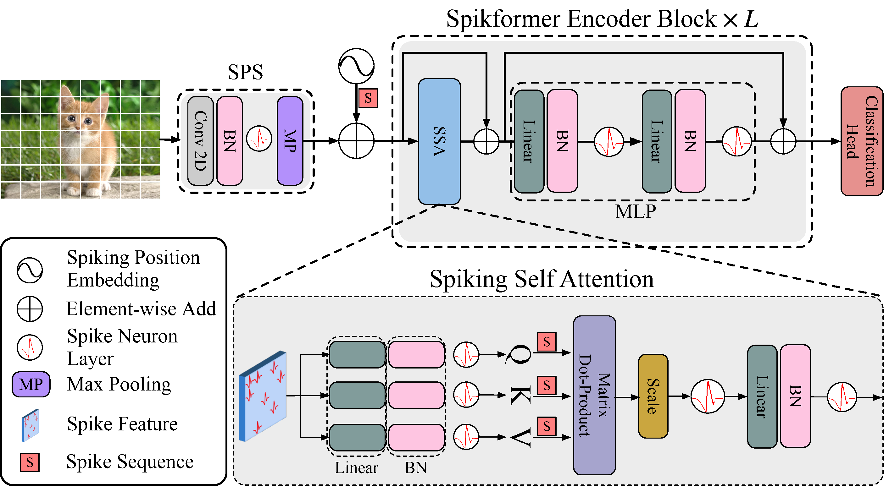
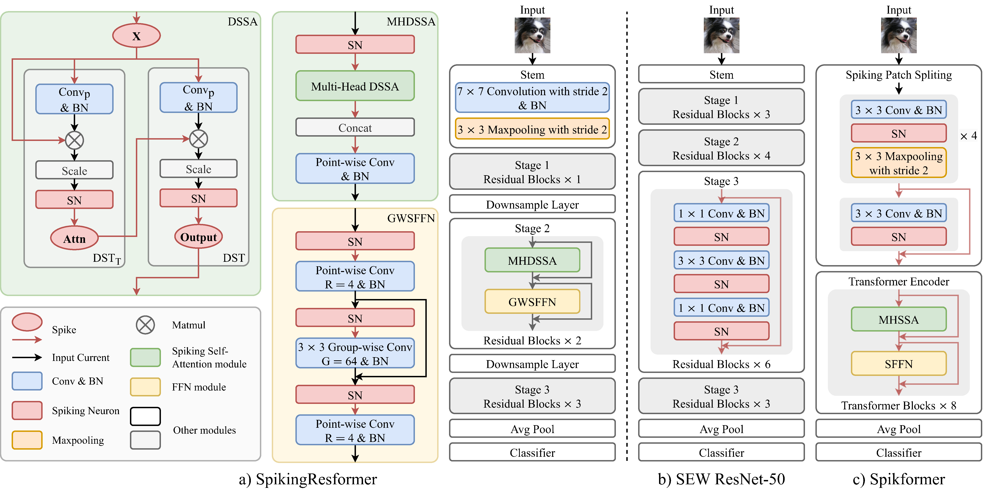

Spiking Transformer Construction, Training, and Improvements
===============================================================

Tutorial author: `Zhou Zhaokun <https://github.com/ZK-Zhou>`_ , `Yifan Huang (AllenYolk) <https://github.com/AllenYolk>`_

中文版： :doc:`../cn/spikformer`

Build Spikformer [#spikformer]_ by first implementing its attention block, then assembling a complete image classifier. Spikformer consists of three main components: Spiking Patch Splitting (SPS), Spiking Self Attention (SSA), and Multi-Layer Perceptron (MLP), stacked as one SPS followed by multiple SSA-MLP blocks. See :doc:`./train_large_scale_snn` for the training workflow and :doc:`./distributed_training` for Spikformer distributed training configurations. The specific SSA and Spikformer are shown in the figure:

Building a Spiking Transformer
---------------------------------------

First, import the relevant modules:

.. code-block:: python

    import torch
    import torch.nn as nn
    from spikingjelly.activation_based import neuron

SSA takes a sequence shaped ``[T, B, N, C]``, where T is the number of time steps, B the batch size, N the number of tokens, and C the channel count. Apply a linear projection, BatchNorm, and an LIF neuron to obtain each of Q, K, and V. The neurons produce nonnegative binary spikes, so attention uses their matrix products without Softmax:

.. code-block:: python

    class SSA(nn.Module):
        def __init__(self, dim, num_heads=8):
            super().__init__()
            assert dim % num_heads == 0, f"dim {dim} should be divided by num_heads {num_heads}."
            self.dim = dim
            self.num_heads = num_heads
            self.scale = 0.125

            self.q_linear = nn.Linear(dim, dim)
            self.q_bn = nn.BatchNorm1d(dim)
            self.q_lif = neuron.LIFNode(step_mode="m", detach_reset=True)

            self.k_linear = nn.Linear(dim, dim)
            self.k_bn = nn.BatchNorm1d(dim)
            self.k_lif = neuron.LIFNode(step_mode="m", detach_reset=True)

            self.v_linear = nn.Linear(dim, dim)
            self.v_bn = nn.BatchNorm1d(dim)
            self.v_lif = neuron.LIFNode(step_mode="m", detach_reset=True)

            self.attn_lif = neuron.LIFNode(step_mode="m", v_threshold=0.5, detach_reset=True)

            self.proj_linear = nn.Linear(dim, dim)
            self.proj_bn = nn.BatchNorm1d(dim)
            self.proj_lif = neuron.LIFNode(step_mode="m", detach_reset=True)

        def forward(self, x):
            T,B,N,C = x.shape

            x_for_qkv = x.flatten(0, 1)  # TB, N, C
            q_linear_out = self.q_linear(x_for_qkv)  # [TB, N, C]
            q_linear_out = self.q_bn(q_linear_out. transpose(-1, -2)).transpose(-1, -2).reshape(T, B, N, C).contiguous()
            q_linear_out = self.q_lif(q_linear_out)
            q = q_linear_out.reshape(T, B, N, self.num_heads, C//self.num_heads).permute(0, 1, 3, 2, 4).contiguous()

            k_linear_out = self.k_linear(x_for_qkv)
            k_linear_out = self.k_bn(k_linear_out. transpose(-1, -2)).transpose(-1, -2).reshape(T, B, N, C).contiguous()
            k_linear_out = self.k_lif(k_linear_out)
            k = k_linear_out.reshape(T, B, N, self.num_heads, C//self.num_heads).permute(0, 1, 3, 2, 4).contiguous()

            v_linear_out = self.v_linear(x_for_qkv)
            v_linear_out = self.v_bn(v_linear_out. transpose(-1, -2)).transpose(-1, -2).reshape(T, B, N, C).contiguous()
            v_linear_out = self.v_lif(v_linear_out)
            v = v_linear_out.reshape(T, B, N, self.num_heads, C//self.num_heads).permute(0, 1, 3, 2, 4).contiguous()

            attn = (q @ k.transpose(-2, -1)) * self.scale

            x = attn @ v
            x = x.transpose(2, 3).reshape(T, B, N, C).contiguous()
            x = self.attn_lif(x)
            x = x.flatten(0, 1)
            x = self.proj_lif(self.proj_bn(self.proj_linear(x).transpose(-1, -2)).transpose(-1, -2).reshape(T, B, N, C))

            return x

Combine SSA with :class:`spikingjelly.activation_based.model.spikformer.SpikformerMLP` to build a Transformer block. The MLP expects tokens in the last dimension, so transpose the input and output around it. The additions below use SEW-style residuals: the branches emit spikes before addition. MS-style residuals require moving the neurons within SSA and the MLP:

.. code-block:: python

    from spikingjelly.activation_based.model.spikformer import SpikformerMLP

    class Block(nn.Module):
        def __init__(self, dim, num_heads, mlp_ratio=4.):
            super().__init__()
            self.attn = SSA(dim, num_heads=num_heads)
            mlp_hidden_dim = int(dim * mlp_ratio)
            self.mlp = SpikformerMLP(in_features=dim, hidden_features=mlp_hidden_dim, out_features=dim)

        def forward(self, x):
            x = x + self.attn(x)
            x = x + self.mlp(x.transpose(-1, -2)).transpose(-1, -2)
            return x

For a complete model with patch splitting, token-last Transformer blocks, and a readout, use :func:`spikingjelly.activation_based.model.spikformer.spikformer_ti`:

.. code-block:: python

    import torch
    from spikingjelly.activation_based.model.spikformer import spikformer_ti
    from spikingjelly.activation_based import functional

    net = spikformer_ti(T=4, img_size_h=32, img_size_w=32, num_classes=10).eval()
    functional.set_step_mode(net, 'm')
    x_seq = torch.rand([4, 2, 3, 32, 32])
    with torch.no_grad():
        y_seq = net(x_seq)
    print(f'y_seq.shape={y_seq.shape}')
    functional.reset_net(net)

The output is ``y_seq.shape=torch.Size([4, 2, 10])``: one class-score vector per time step and image. Average over time with ``y_seq.mean(0)`` for classification. Reset the neuron state before processing another independent batch.

``spikformer_ti`` is the tiny configuration. ``spikformer_s`` and
``spikformer_cifar10`` provide the small ImageNet and CIFAR-10 configurations
respectively. Training defaults are provided by the corresponding training configuration classes.

For tasks that need multiple spatial resolutions, you can use QKformer as a reference for a hierarchical Spikformer.

Improved SSA Implementation
--------------------------------

SpikingJelly provides a token-last SSA implementation in :class:`SpikingSelfAttention <spikingjelly.activation_based.layer.attention.SpikingSelfAttention>`.
Compared with the ``SSA`` introduced in the previous section, :class:`SpikingSelfAttention <spikingjelly.activation_based.layer.attention.SpikingSelfAttention>` introduces the following improvements.

#. Assume that both the input and output have shape ``[T, B, C, N]`` instead of ``[T, B, N, C]`` (token-last). ``Conv1d`` is used instead of ``Linear`` layers. As a result, no tensor transposition is required before or after ``BatchNorm1d``.
#. The three Conv-BN-LIF blocks for Q, K, and V are merged into a single block whose channel dimension is three times larger. This allows ``q``, ``k``, and ``v`` to be generated in a single forward pass.
#. After splitting into heads, ``q``, ``k``, and ``v`` change from ``[T, B, num_heads, N, C // num_heads]`` to ``[T, B, num_heads, C // num_heads, N]``. The per-head multiplication changes from ``q @ k.transpose(-2, -1) @ v`` to ``v @ k.transpose(-2, -1) @ q``.

.. note::

    For this derivation, consider one attention head and let C denote its channel count. Denote the original ``q``, ``k``, and ``v`` tensors of shape ``[T, B, N, C]`` as :math:`Q`, :math:`K`, and :math:`V`. The tensor multiplication (i.e., batched matrix multiplication) in SSA can then be written as

    .. math::

        X = Q K^T V,

    where :math:`K^T` denotes transposing the last two dimensions of :math:`K`. In the improved implementation, the new ``q``, ``k``, and ``v`` tensors, as well as the resulting tensor ``x``, have shape ``[T, B, C, N]``, which corresponds to :math:`Q^T`, :math:`K^T`, :math:`V^T`, and :math:`X^T`. Denoting these token-last tensors as :math:`Q'`, :math:`K'`, :math:`V'`, and :math:`X'`, we have

    .. math::

        X' &= X^T \\
           &= (Q K^T V)^T \\
           &= V^T K Q^T \\
           &= V' K'^T Q'

    Therefore, for the token-last tensors, the correct order of tensor multiplication is ``v @ k.transpose(-2, -1) @ q``.

The implementation below illustrates these changes. See :class:`SpikingSelfAttention <spikingjelly.activation_based.layer.attention.SpikingSelfAttention>` for the complete implementation.

.. code:: python

    import torch
    import torch.nn as nn
    from spikingjelly.activation_based import neuron
    from spikingjelly.activation_based.layer import SeqToANNContainer

    class SpikingSelfAttention(nn.Module):
        def __init__(self, dim, num_heads=8):
            super().__init__()
            assert dim % num_heads == 0, f"dim {dim} should be divided by num_heads {num_heads}."
            self.dim = dim
            self.num_heads = num_heads
            self.head_dim = dim // num_heads
            self.scale = 0.125

            self.qkv_conv_bn = SeqToANNContainer(
                nn.Conv1d(dim, dim * 3, kernel_size=1, stride=1, bias=False),
                nn.BatchNorm1d(dim*3),
            )
            self.qkv_lif = neuron.LIFNode(step_mode="m", detach_reset=True)

            self.attn_lif = neuron.LIFNode(step_mode="m", v_threshold=0.5, detach_reset=True)

            self.proj_conv_bn = SeqToANNContainer(
                nn.Conv1d(dim, dim, kernel_size=1, stride=1, bias=False),
                nn.BatchNorm1d(dim),
            )
            self.proj_lif = neuron.LIFNode(step_mode="m", detach_reset=True)

        def forward(self, x_seq: torch.Tensor):
            T, B, C, N = x_seq.shape

            qkv = self.qkv_conv_bn(x_seq)
            qkv = self.qkv_lif(qkv) # [T, B, 3*C, N]
            qkv = qkv.reshape(T, B, 3*self.num_heads, C // self.num_heads, N)

            qt, kt, vt = qkv.chunk(3, dim=2)
            # qt, kt, vt.shape = [T, B, NUM_HEADS, Cph, N]
            x_seq = vt @ kt.transpose(-2, -1)
            x_seq = (x_seq@qt) * self.scale # [T, B, NUM_HEADS, Cph, N]

            x_seq = self.attn_lif(x_seq).reshape(T, B, C, N)

            x_seq = self.proj_conv_bn(x_seq)
            x_seq = self.proj_lif(x_seq) # [T, B, C, N]
            return x_seq

.. note::

    If token-last format is adopted, the implementation of ``MLP`` should also be changed from ``Linear`` to ``Conv1d`` in order to avoid unnecessary ``reshape`` operations that involve data copying.

Improving Spiking Transformer
-----------------------------
The modeling form of Spiking Self Attention mechanism is still in open exploration, and there are multiple improvements, including: improving the form and calculation method of QKV, enhancing spatial-temporal attention capability of QKV, designing spike position encoding, and accelerating SSA block splitting.
You can also modify the MLP and SPS feedforward modules.
One Spikformer variant is SpikingResformer [#spikingresformer]_, shown below:

.. [#spikformer] Zhou Zhaokun, Zhu Yuesheng, He Chao, Wang Yaowei, Yan Shuicheng, Tian Yonghong, Yuan Li. Spikformer: When Spiking Neural Network Meets Transformer [C]. Proceedings of International Conference on Learning Representations, 2023.
.. [#spikingresformer] Shi Xinyu, Hao Zecheng, Yu Zhaofei. SpikingResformer: Bridging ResNet and Vision Transformer in Spiking Neural Networks [C]. Proceedings of the IEEE/CVF Conference on Computer Vision and Pattern Recognition, 2024: 5610-5619.
