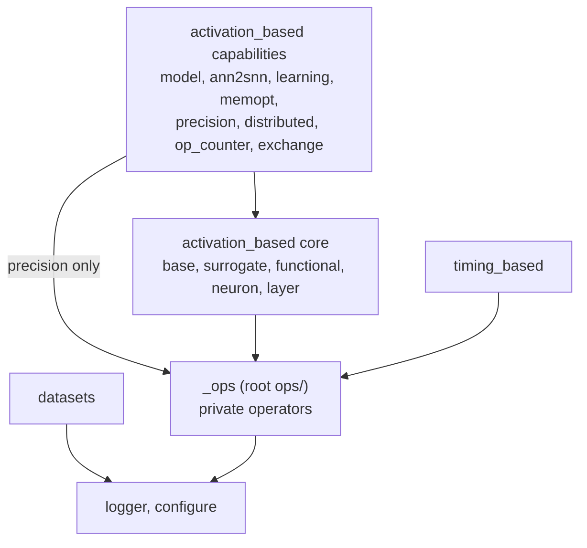

## Drivers

SNN simulation is a hot loop over stateful neurons, so kernels must be fast. Users
write plain PyTorch (see `goal`), so public modules hide those kernels. The split
between public modules and private kernels is the main boundary in the system.

## Topology

- `logger` and `configure` import nothing else from the package, and neither does
  `visualizing`.
- `nsys` adds instrumentation and imports `base` and `layer` for their module types.
- `activation_based` production code does not import `datasets`; only its examples do.
  Distributed vision uses torchvision datasets.
- `timing_based` shares only `_ops` with `activation_based`. No rule requires this, and
  reuse between them is allowed where it helps.
- `benchmark/`, `tools/`, `test/` and `docs/` are outside the wheel and may depend on
  anything. Language-model architecture adapters (Qwen2, SpikeLM) are in
  `benchmark/snn_llm`.

Edges between `activation_based` modules are in `activation-based`.

## Decisions

- **One private operator package.** Fused kernels live in `ops`. Only `functional`,
  `neuron`, `precision` and `timing_based` import it.
- **Optional dependencies are extras.** Triton, NIR, Megatron, SGLang, Transformer
  Engine and Qwen are extras; Lava and Lynxi SDKs are installed separately. Base
  imports must not require them. They load lazily or inside `try`/`except`, with a
  clear `ImportError` when a feature needs them.
- **`SJ_*` environment variables are the configuration surface.** `configure` reads
  package options once at first import, so they must be set before Python starts.
  `ops` reads provider overrides itself.
- **The library logger is silent by default.** `logger` disables the `spikingjelly`
  namespace, and only applications add sinks.
- **Documentation lives in docstrings.** Pages in `docs/source/APIs` render them
  bilingually, in the format `AGENTS.md` requires. Tutorials are separate `cn` and `en`
  trees.

## Invariants

- Importing `spikingjelly` or `spikingjelly.activation_based` does no work: both
  `__init__` files export nothing, so importing a module loads only what it needs.
  Importing neurons registers operators without loading CUDA providers.
- `spikingjelly._ops` exists only through the `package-dir` mapping in
  `pyproject.toml`, so a source checkout must be installed in editable mode.
- Production code logs through `spikingjelly.logger`, with lazy `{}` formatting and
  no `print`.

## Known limitations

- **`model` imports `distributed.vision`.** `model.sew_resnet` and `model.spikformer`
  import `ModelBuilder`, `NeuronConfig` and related types from
  `distributed.vision.config`, which also loads the vision training stack. This is
  known layering debt: those base classes should move out of `distributed`, and new
  models must not add more such edges.
- **CI does not exercise GPU paths.** CI runs CPU tests and excludes
  `test_distributed_*`, so only release profiles verify CUDA, Triton, native builds and
  distributed execution (see `tools`).
- **`nsys` has no tests** in `test/`.
